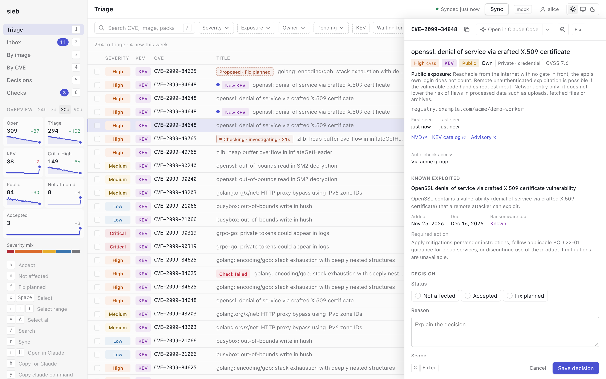
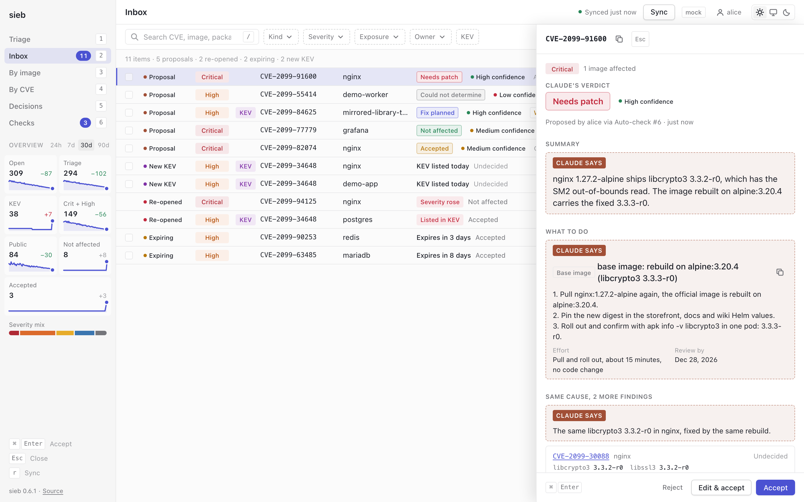

<p align="center">
  
</p>

# sieb

Sift through Trivy findings, triage what matters, silence the rest.

sieb is a triage app for the vulnerability findings of the
[Trivy Operator](https://github.com/aquasecurity/trivy-operator). It collects the findings of your
cluster and you decide each one: not affected, accepted or fix planned. Decisions expire and
re-open when the facts change, and a decided finding stops alerting in Prometheus while it stays
visible in sieb and in your dashboards.

Triage with Claude is optional and off by default. Once connected, Claude investigates a finding,
in your chat or editor or unattended inside the cluster with Auto-check, and files a proposal with
its evidence. You review the proposal in the Inbox and accept, edit or reject it. Nothing Claude
proposes takes effect before a person accepts it.

Without Claude, everything in the first paragraph works on its own.

## Screenshots

| Triage | Proposal review | Mobile |
| --- | --- | --- |
| <picture><source media="(prefers-color-scheme: dark)" srcset=".github/assets/screenshot-triage-dark.png"></picture> | <picture><source media="(prefers-color-scheme: dark)" srcset=".github/assets/screenshot-proposal-dark.png"></picture> | <picture><source media="(prefers-color-scheme: dark)" srcset=".github/assets/screenshot-mobile-dark.png"></picture> |

## Features

Triage and decisions

- A Triage list of the open findings nobody has decided yet, ranked by KEV listing, exposure and
  severity
- Decisions for one image or for all images of a CVE, with a reason, an optional expiry and, for
  not affected, an optional OpenVEX justification
- Bulk decisions for the checked findings or for every open image of a CVE
- Decisions re-open on their own when a finding gets more severe or becomes KEV listed, and every
  decision keeps its history

Alerts

- `sieb_suppressed` on `/metrics` silences Prometheus alerts per CVE and image, without hiding the
  finding anywhere

Triage with Claude (optional)

- A connector for claude.ai and Claude Code: Claude reads findings, images and decisions and files
  proposals, which you review in the Inbox with a What to do section and the evidence
- A hand-off button sends one finding or all checked findings to Claude with the prompt prefilled
- Auto-check investigates queued findings unattended in the cluster, on public images and, with
  stored read credentials, on private images and their source code

Views and context

- An Inbox of what waits for you, and views by image, by CVE and by decision
- KEV details from the CISA catalog, exposure tiers and owner labels from your own rules, and
  overview stats with a trend

Running it

- A single Node process with an embedded SQLite file, behind your forward-auth proxy or with its
  own OpenID Connect login
- Light and dark theme, a phone layout and keyboard shortcuts

## Quick start

Mock mode runs sieb on synthetic findings and needs no cluster. It requires Node 26 or newer:

```sh
npm install
npm run dev:mock
```

Open http://localhost:5173. Every sync in mock mode flips between two sets of findings, so you
see new, resolved and re-rated findings.

To try Claude against the mock findings, start sieb with the integration turned on:

```sh
SIEB_MCP_ENABLED=true npm run dev:mock
```

Open the user menu (`dev` in the top bar), choose **API tokens…**, create a token and run the
`claude mcp add` command sieb shows. Then ask Claude Code "how are we doing?". The connector for
claude.ai needs a public https URL, see [Connect](docs/working-with-claude.md#connect).

To run sieb in your cluster, follow [Getting started](docs/getting-started.md).

## How it fits together

1. The Trivy Operator scans your workloads, and a recording rule in Prometheus turns its metrics
   into one series per finding.
2. sieb syncs those findings into SQLite and shows the undecided ones in Triage.
3. You decide a finding, yourself or by accepting a proposal from Claude.
4. For every open finding with a decision in effect (not affected or accepted), sieb exports one
   series on `/metrics`.
5. Two recording rules subtract those series from your findings, and your alerts read the result.

This is the series sieb exports for one silenced finding:

```text
sieb_suppressed{vuln_id="CVE-2099-10081", image_ref="registry.example.com/acme/shop"} 1
```

[How decisions mute alerts](docs/triage.md#how-decisions-mute-alerts) explains which decisions
silence what, and [Silencing alerts](docs/prometheus-rules.md#silencing-alerts) has the rules.

## Documentation

Use

- [Triage](docs/triage.md): findings, decisions, expiry, the views, the Inbox, filters, shortcuts
- [Working with Claude](docs/working-with-claude.md): connecting Claude, asking questions, hand-off,
  reviewing proposals
- [Auto-check](docs/auto-check.md): unattended checks in the cluster, setup, private access

Run

- [Getting started](docs/getting-started.md): the first deployment, step by step
- [Deployment](docs/deployment.md): images, authentication, ingress, manifests, security checklist
- [Prometheus rules](docs/prometheus-rules.md): the label contract, example rules, silencing rules
- [Operations](docs/operations.md): metrics, backup, upgrades, secrets, troubleshooting

Reference

- [Configuration](docs/reference/configuration.md): every environment variable
- [HTTP API](docs/reference/api.md): routes, bodies, errors, limits
- [MCP](docs/reference/mcp.md): the endpoint, the tools, the proposal contract
- [Auto-check internals](docs/reference/auto-check-internals.md): how a check runs and what it can
  reach

Project

- [CONTRIBUTING.md](CONTRIBUTING.md): development setup, scripts, code layout, releasing
- [SECURITY.md](SECURITY.md): reporting a vulnerability, scope

## License

[AGPL-3.0-or-later](LICENSE)
