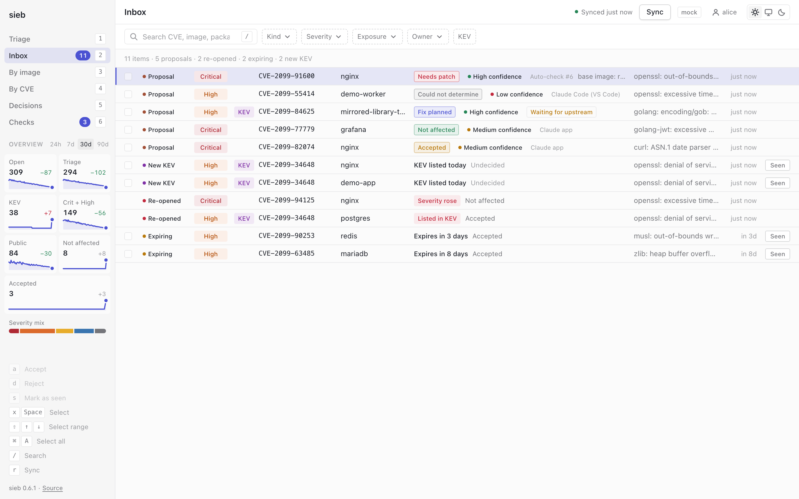

<p align="center">
  
</p>

# sieb

Sift through Trivy findings, triage what matters, silence the rest.

sieb is a small, keyboard-driven triage inbox for the vulnerability findings of the
[Trivy Operator](https://github.com/aquasecurity/trivy-operator). It syncs the findings of your
cluster from Prometheus and the `VulnerabilityReport` resources into SQLite, lets you decide per CVE
and image (not affected, accepted, fix planned), and exports every effective decision on `/metrics`
as `sieb_suppressed{vuln_id, image_ref}`. Your Prometheus alert rules drop the silenced findings with
`unless`, while the findings themselves stay visible in sieb and in your dashboards.

## Screenshots

| Triage | Finding panel | Mobile |
| --- | --- | --- |
| <picture><source media="(prefers-color-scheme: dark)" srcset=".github/assets/screenshot-inbox-dark.png"></picture> | <picture><source media="(prefers-color-scheme: dark)" srcset=".github/assets/screenshot-panel-dark.png"></picture> |  |

## Features

- An Inbox of what waits for you, newest first: Claude's decision proposals, re-opened decisions,
  decisions expiring within 14 days and findings newly KEV listed, with the open count as a badge
  in the navigation; expiring and KEV items can be marked as seen
- Triage list of the undecided open findings, ranked by KEV listing, optional exposure and
  severity, with views per image, per CVE and per decision; optional free-form owner labels put
  your own images first. A "Pending" filter keeps the findings with an open proposal, a re-opened
  decision, a new KEV listing or a queued or running Auto-check, or those with none of these
- Exposure tiers `public`, `gated` and `internal`, with their meaning in the exposure tooltip and
  the finding panel and handed to Claude, see [exposure tiers](docs/prometheus-rules.md#exposure-tiers)
- KEV listing from the CISA Known Exploited Vulnerabilities catalog, fetched daily with date
  added, due date, ransomware use and required action in the finding panel; alternatively from a
  Prometheus query, or switched off. A KEV toggle in the filter bar keeps only KEV listed findings
- By image as a risk view: findings decided not affected leave the counts, accepted risk stays
  in; by CVE as a triage view that hides CVEs whose open findings are all decided. A filter toggle
  brings either back, and an all clear state shows when nothing is left to decide
- Decisions per image or for all images of a CVE (not affected, accepted or fix planned), with
  reason, optional expiry and bulk actions; not affected takes an optional OpenVEX justification
  such as component not present (false positive). Unsaved decision drafts are guarded against
  row clicks, navigation and closing the tab
- Decisions re-open on their own when a governed finding gets more severe or becomes KEV listed
- History of every decision, and overview stats with a 7, 30 or 90 day trend that count not
  affected and accepted findings apart
- `/metrics` for Prometheus: alert silencing without hiding findings, optionally on a separate
  port
- Login through your forward-auth proxy (default) or sieb's own OpenID Connect login with
  sessions and logout, see [authentication](docs/deployment.md#authentication)
- Optional Claude integration over MCP, off by default: a custom connector in claude.ai (OAuth
  through your identity provider) serves the Claude apps and, with the same account, Claude Code,
  personal API tokens from the user menu serve `claude -p`, CI and scripts. Claude queries
  findings, images and decisions and, with `sieb:propose`, files verdicts as proposals you accept
  or reject, and a hand-off button
  (`Shift+H`, `h`, `y`) opens a finding in Claude Code (app, terminal or VS Code) or Claude
  chat with the prompt prefilled, never sent, or copies it; in Triage it hands off all checked
  rows in one prompt, see [docs/mcp.md](docs/mcp.md). Proposals that mean patching name the
  patch action at the layer that ships the fix (dependency, base image, image or platform), with
  a copy button for the target version or digest
- Optional Auto-check, off by default: queue findings on public images from the finding panel or
  for the checked rows in Triage, and a separate worker investigates one at a time with headless
  Claude Code in a throwaway copy of the image, without a shell or cluster access, and files a
  proposal to the Inbox. The Checks page shows the running check, the queue, recent checks with
  Claude's reply and a Retry action, and the usage of the last 7 and 30 days; a toast tells you
  when one of your checks ends. See [docs/auto-check.md](docs/auto-check.md)
- Single Node process with an embedded SQLite file, no external database
- Fully keyboard driven: shortcuts per view, clickable in the sidebar, and `a`, `n` or `f` decide
  all checked rows in one dialog. The Inbox, Triage and tree lists are virtualized, phones get a bottom tab bar
  and a selection bar. Light and dark theme

## Quick start

Requires Node 26 or newer. Mock mode uses synthetic fixtures and needs no cluster:

```sh
npm install
npm run dev:mock
```

Open http://localhost:5173. The Vite dev server proxies `/api`, `/auth`, `/metrics`, `/mcp` and
`/.well-known` to the API server on port 3100. Every sync in mock mode flips between two fixture
states, so new, resolved and re-rated findings show up without a cluster.

To try the Claude integration against the fixtures, turn it on for the run:

```sh
SIEB_MCP_ENABLED=true npm run dev:mock
```

Open the user menu (`dev` in the top bar), choose **API tokens…**, create a token and run the
`claude mcp add` command sieb shows, which points Claude Code at `http://localhost:5173/mcp`. Then
ask Claude Code "how are we doing?". The connector in claude.ai, the recommended setup for the
Claude apps and Claude Code, needs a public https URL and an OAuth client at your identity
provider, see [docs/mcp.md](docs/mcp.md#connecting-claude).

Live mode reads your cluster through read-only `kubectl` (current context, or `SIEB_KUBE_CONTEXT`):

```sh
npm run dev
```

It needs the Trivy Operator with `operator.metricsVulnIdEnabled: true`, and Prometheus with a
findings recording rule that you provide. See [docs/prometheus-rules.md](docs/prometheus-rules.md)
for the label contract and an example rule set. The KEV listing comes from the CISA feed, which sieb
fetches itself, so it needs outbound HTTPS to `www.cisa.gov` unless you set `SIEB_KEV_SOURCE`. For
running sieb in the cluster, see [docs/deployment.md](docs/deployment.md).

## Configuration

All variables are optional. `npm run dev` and `npm run dev:server` read them from `.env.local`,
copy [.env.example](.env.example) as a starting point; the mock scripts ignore that file, pass
variables inline as above.

| Variable | Default | Meaning |
| --- | --- | --- |
| `SIEB_SOURCE` | `kubectl` | `mock`, `kubectl` (local, read-only kubectl) or `incluster` (ServiceAccount) |
| `SIEB_DB_PATH` | `data/sieb.db`, mock: `data/sieb-mock.db` | SQLite file, relative to the working directory |
| `SIEB_HOST` | `127.0.0.1` | Listen address |
| `SIEB_PORT` | `3100` | Listen port, also the Vite proxy target |
| `SIEB_FINDINGS_QUERY` | `sieb:trivy_finding:info` | PromQL for the findings, see [label contract](docs/prometheus-rules.md#findings-query) |
| `SIEB_KEV_SOURCE` | `cisa` | `cisa` (sieb fetches the CISA KEV feed once a day), `prometheus` (the KEV query, flag only) or `none` (no KEV), see [KEV source](docs/api.md#kev-source) |
| `SIEB_KEV_URL` | CISA feed | http(s) URL of the CISA KEV JSON feed or a mirror of it, used by `cisa` |
| `SIEB_KEV_QUERY` | `sieb:kev:listed` | PromQL for the KEV list with `SIEB_KEV_SOURCE=prometheus`, one series per `vuln_id` |
| `SIEB_KUBE_CONTEXT` | current context | kubectl context for the `kubectl` source |
| `SIEB_PROMETHEUS_SERVICE` | `monitoring/kube-prometheus-stack-prometheus:9090` | Prometheus service as `namespace/name:port`, reached through the API server proxy by the `kubectl` source |
| `SIEB_PROMETHEUS_URL` | `http://kube-prometheus-stack-prometheus.monitoring.svc:9090` | Prometheus base URL for the `incluster` source |
| `SIEB_SYNC_INTERVAL_MINUTES` | `15` | Minutes between automatic syncs |
| `SIEB_USER_HEADER` | `X-authentik-username` | header mode: username header set by your forward-auth proxy |
| `SIEB_DEV_USER` | `dev` | header mode: acting user without that header, ignored in production |
| `SIEB_AUTH` | `header` | `header` trusts the forward-auth username header, `oidc` runs sieb's own OpenID Connect login with sessions and ignores the header, see [authentication](docs/deployment.md#authentication) |
| `SIEB_OIDC_ISSUER` | empty | oidc: issuer URL exactly as the provider shows it, base of OpenID discovery, https in production |
| `SIEB_OIDC_CLIENT_ID` | empty | oidc: client id of the confidential UI login client |
| `SIEB_OIDC_CLIENT_SECRET` | empty | oidc: client secret, never logged |
| `SIEB_OIDC_REQUIRED_GROUP` | empty | oidc: entry of the `groups` claim a user must have, empty admits every user of the issuer |
| `SIEB_SESSION_HOURS` | `12` | oidc: absolute session lifetime in hours, 1 to 168 |
| `SIEB_OIDC_DISPLAY_NAME` | `SSO` | oidc: provider name on the sign-in button, "Sign in with SSO" |
| `SIEB_METRICS_PORT` | empty | Serves `/metrics` on this separate port only, the main port then answers 404; required in oidc mode |
| `SIEB_ALLOWED_HOSTS` | empty | Comma list of `Host` values accepted besides loopback, e.g. your public hostname |
| `SIEB_MCP_ENABLED` | `false` | `true` or `1` serves `/mcp`, the personal token routes and, with OAuth, its metadata, see [docs/mcp.md](docs/mcp.md) |
| `SIEB_PUBLIC_URL` | derived per request | Origin sieb is reached at (`https://sieb.example.com`, no path or trailing slash, https in production), for absolute links in MCP results, the MCP resource URL and the OIDC redirect URI; required for OAuth and in oidc mode |
| `SIEB_MCP_ALLOWED_ORIGINS` | empty | Comma list of browser origins `/mcp` accepts besides its own host; requests without `Origin` always pass |
| `SIEB_OAUTH_ISSUER` | empty | OAuth issuer of the Claude connector, the exact `iss` claim and the base of OpenID discovery; set together with `SIEB_OAUTH_CLIENT_ID`, empty accepts personal tokens only |
| `SIEB_OAUTH_CLIENT_ID` | empty | Client id of the MCP client at the identity provider (a public client with PKCE), the exact `aud` claim |
| `SIEB_OAUTH_JWKS_URL` | discovered | Key set URL of the issuer, unset reads `jwks_uri` from its OpenID configuration |
| `SIEB_OAUTH_REQUIRED_GROUP` | empty | Entry of the `groups` claim an OAuth caller must have, empty admits every user of the issuer |
| `SIEB_OAUTH_CLIENT_LABEL` | `Claude` | Client name of OAuth callers in logs and tool results, shared by the Claude apps and Claude Code through the connector |
| `SIEB_PUBLIC_REGISTRIES` | `docker.io`, `index.docker.io`, `registry-1.docker.io`, `mirror.gcr.io`, `ghcr.io`, `quay.io`, `registry.k8s.io`, `gcr.io`, `public.ecr.aws`, `mcr.microsoft.com`, `cgr.dev` | Comma list of registry hosts whose images count as public for the source access Claude sees; own images (owner `self`) are always private, images of other registries unknown, see [source access](docs/api.md#source-access) |
| `SIEB_SOURCE_URL` | upstream tag | http(s) URL of the source code the UI links next to the version (AGPL), for forks; unset links `https://github.com/bernhardkelm/sieb/tree/<version>` |
| `SIEB_CHECKS_ENABLED` | `false` | `true` or `1` turns on Auto-check: users queue findings on public images, a separate worker runs headless Claude Code and files a proposal, see [Auto-check](docs/api.md#auto-check); needs `SIEB_MCP_ENABLED` and `SIEB_PUBLIC_URL` |
| `SIEB_WORKER_PORT` | empty | Auto-check: port of the listener serving only the worker routes, required when on, must differ from `SIEB_PORT` and `SIEB_METRICS_PORT` |
| `SIEB_WORKER_SECRET` | empty | Auto-check: bearer secret the worker sends, at least 32 characters without whitespace, required when on, never logged; sieb reads it from this variable only, the worker also takes `SIEB_WORKER_SECRET_FILE` |
| `SIEB_CHECK_TIMEOUT_SECONDS` | `1200` | Auto-check: time limit of one check in seconds, 1 to 14400; its token expires 10 minutes later |
| `SIEB_CHECK_MAX_TURNS` | `60` | Auto-check: turn limit handed to Claude Code, 1 to 500 |

`NODE_ENV=production` and the `incluster` source refuse the mock source and disable the dev user.
`SIEB_AUTH=oidc` needs `SIEB_OIDC_ISSUER`, `SIEB_OIDC_CLIENT_ID`, `SIEB_OIDC_CLIENT_SECRET`,
`SIEB_PUBLIC_URL` and `SIEB_METRICS_PORT`, never uses the dev user, and its client must differ
from `SIEB_OAUTH_CLIENT_ID`.
The built client in `dist/` is served whenever `dist/index.html` exists. The `SIEB_OAUTH_*`
variables are ignored while `SIEB_MCP_ENABLED` is off.
`SIEB_CHECKS_ENABLED=true` refuses to start without `SIEB_MCP_ENABLED`, `SIEB_PUBLIC_URL`,
`SIEB_WORKER_PORT` and `SIEB_WORKER_SECRET`.

## How silencing works

A decision is effective while its status is `not_affected` or `accepted` and it is neither revoked,
expired nor re-opened. For every open finding governed by an effective decision, sieb exports:

```text
sieb_suppressed{vuln_id="CVE-2024-6387", image_ref="index.docker.io/library/nginx"} 1
```

`vuln_id` and `image_ref` (registry + `/` + repository, no tag) match the labels of your findings
rule. Prometheus scrapes sieb as job `sieb`, a recording rule removes the silenced findings from your
findings rule, and your alerts read that result. While sieb is down the last set stays in effect for
up to 6h. Rules, timing and a `SiebDown` alert: [docs/prometheus-rules.md](docs/prometheus-rules.md#silencing-alerts).

## Documentation

- [docs/prometheus-rules.md](docs/prometheus-rules.md): required labels, example recording rules, silencing rules
- [docs/deployment.md](docs/deployment.md): container image, authentication modes, metrics port, Kubernetes manifests, security notes
- [docs/api.md](docs/api.md): HTTP API, finding filters, login routes, decision re-opening, metrics, tokens and the MCP endpoint
- [docs/mcp.md](docs/mcp.md): the claude.ai connector, personal tokens, MCP tools, hand-off, security model
- [docs/auto-check.md](docs/auto-check.md): the Auto-check worker, its security model, the Claude credential (API key or subscription token), worker settings, alerts and Kubernetes manifests
- [CONTRIBUTING.md](CONTRIBUTING.md): development setup, scripts, code layout, releasing
- [SECURITY.md](SECURITY.md): reporting a vulnerability, scope

## License

[AGPL-3.0-or-later](LICENSE)
