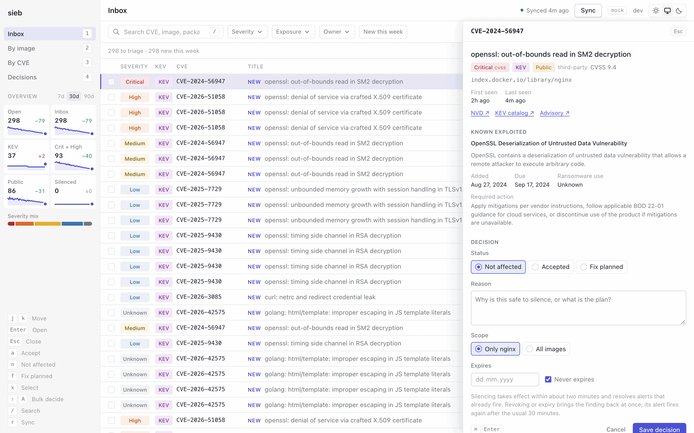
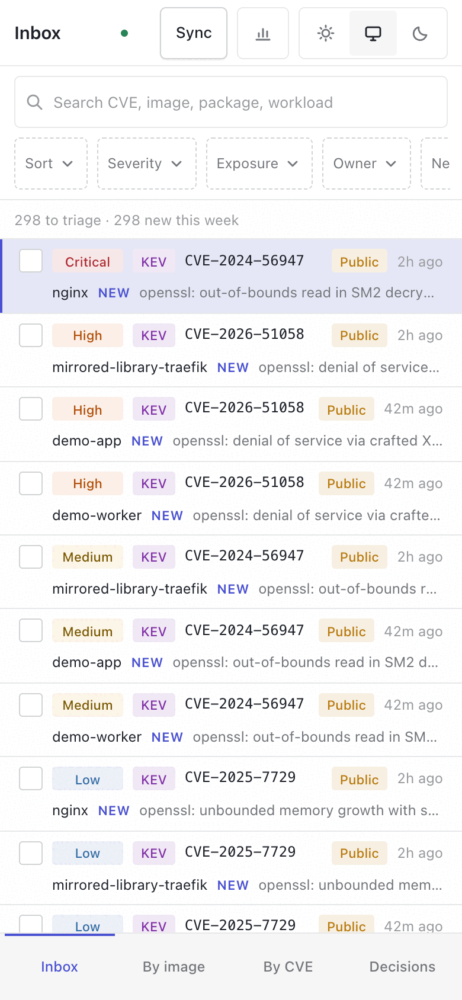

<p align="center">
  
</p>

# sieb

Sift through Trivy findings, triage what matters, silence the rest.

sieb is a small, keyboard-driven triage inbox for the vulnerability findings of the
[Trivy Operator](https://github.com/aquasecurity/trivy-operator). It syncs the findings of your
cluster from Prometheus and the `VulnerabilityReport` resources into SQLite, lets you decide per CVE
and image (not affected, accepted, fix planned), and exports every effective decision on `/metrics`
as `sieb_suppressed{vuln_id, image_ref}`. Your Prometheus alert rules drop the silenced findings with
`unless`, while the findings themselves stay visible in sieb and in your dashboards.

## Screenshots

| Inbox | Finding panel | Mobile |
| --- | --- | --- |
| <picture><source media="(prefers-color-scheme: dark)" srcset=".github/assets/screenshot-inbox-dark.png"></picture> | <picture><source media="(prefers-color-scheme: dark)" srcset=".github/assets/screenshot-panel-dark.png"></picture> |  |

## Features

- Inbox of open findings, ranked by KEV listing, optional exposure and severity, with views per
  image, per CVE and per decision; optional free-form owner labels put your own images first
- KEV listing from the CISA Known Exploited Vulnerabilities catalog, fetched daily with date
  added, due date, ransomware use and required action in the finding panel; alternatively from a
  Prometheus query, or switched off
- Decisions per image or for all images of a CVE, with reason, optional expiry and bulk actions
- Decisions re-open on their own when a governed finding gets more severe or becomes KEV listed
- History of every decision, and overview stats with a 7, 30 or 90 day trend
- `/metrics` for Prometheus: alert silencing without hiding findings
- Single Node process with an embedded SQLite file, no external database
- Fully keyboard driven, light and dark theme

## Quick start

Requires Node 26 or newer. Mock mode uses synthetic fixtures and needs no cluster:

```sh
npm install
npm run dev:mock
```

Open http://localhost:5173. The Vite dev server proxies `/api` and `/metrics` to the API server on
port 3100. Every sync in mock mode flips between two fixture states, so new, resolved and re-rated
findings show up without a cluster.

Live mode reads your cluster through read-only `kubectl` (current context, or `SIEB_KUBE_CONTEXT`):

```sh
npm run dev
```

It needs the Trivy Operator with `operator.metricsVulnIdEnabled: true`, and Prometheus with a
findings recording rule that you provide. See [docs/prometheus-rules.md](docs/prometheus-rules.md)
for the label contract and an example rule set. The KEV listing comes from the CISA feed, which sieb
fetches itself, so it needs outbound HTTPS to `www.cisa.gov` unless you set `SIEB_KEV_SOURCE`. For
running sieb in the cluster, see [docs/deployment.md](docs/deployment.md).

## Configuration

All variables are optional. `npm run dev:server` reads them from `.env.local`, copy
[.env.example](.env.example) as a starting point.

| Variable | Default | Meaning |
| --- | --- | --- |
| `SIEB_SOURCE` | `kubectl` | `mock`, `kubectl` (local, read-only kubectl) or `incluster` (ServiceAccount) |
| `SIEB_DB_PATH` | `data/sieb.db`, mock: `data/sieb-mock.db` | SQLite file, relative to the working directory |
| `SIEB_HOST` | `127.0.0.1` | Listen address |
| `SIEB_PORT` | `3100` | Listen port, also the Vite proxy target |
| `SIEB_FINDINGS_QUERY` | `sieb:trivy_finding:info` | PromQL for the findings, see [label contract](docs/prometheus-rules.md#findings-query) |
| `SIEB_KEV_SOURCE` | `cisa` | `cisa` (sieb fetches the CISA KEV feed once a day), `prometheus` (the KEV query, flag only) or `none` (no KEV), see [KEV source](docs/api.md#kev-source) |
| `SIEB_KEV_URL` | CISA feed | http(s) URL of the CISA KEV JSON feed or a mirror of it, used by `cisa` |
| `SIEB_KEV_QUERY` | `sieb:kev:listed` | PromQL for the KEV list with `SIEB_KEV_SOURCE=prometheus`, one series per `vuln_id` |
| `SIEB_KUBE_CONTEXT` | current context | kubectl context for the `kubectl` source |
| `SIEB_PROMETHEUS_SERVICE` | `monitoring/kube-prometheus-stack-prometheus:9090` | Prometheus service as `namespace/name:port`, reached through the API server proxy by the `kubectl` source |
| `SIEB_PROMETHEUS_URL` | `http://kube-prometheus-stack-prometheus.monitoring.svc:9090` | Prometheus base URL for the `incluster` source |
| `SIEB_SYNC_INTERVAL_MINUTES` | `15` | Minutes between automatic syncs |
| `SIEB_USER_HEADER` | `X-authentik-username` | Header with the username set by your forward-auth proxy |
| `SIEB_DEV_USER` | `dev` | Acting user without that header, ignored in production |
| `SIEB_ALLOWED_HOSTS` | empty | Comma list of `Host` values accepted besides loopback, e.g. your public hostname |

`NODE_ENV=production` and the `incluster` source refuse the mock source and disable the dev user.
The built client in `dist/` is served whenever `dist/index.html` exists.

## How silencing works

A decision is effective while its status is `not_affected` or `accepted` and it is neither revoked,
expired nor re-opened. For every open finding governed by an effective decision, sieb exports:

```text
sieb_suppressed{vuln_id="CVE-2024-6387", image_ref="index.docker.io/library/nginx"} 1
```

`vuln_id` and `image_ref` (registry + `/` + repository, no tag) match the labels of your findings
rule. Prometheus scrapes sieb as job `sieb`, a recording rule removes the silenced findings from your
findings rule, and your alerts read that result. While sieb is down the last set stays in effect for
up to 6h. Rules, timing and a `SiebDown` alert: [docs/prometheus-rules.md](docs/prometheus-rules.md#silencing-alerts).

## Documentation

- [docs/prometheus-rules.md](docs/prometheus-rules.md): required labels, example recording rules, silencing rules
- [docs/deployment.md](docs/deployment.md): container image, Kubernetes manifests, security notes
- [docs/api.md](docs/api.md): HTTP API, decision re-opening, metrics
- [CONTRIBUTING.md](CONTRIBUTING.md): development setup, scripts, code layout, releasing
- [SECURITY.md](SECURITY.md): reporting a vulnerability

## License

[AGPL-3.0-or-later](LICENSE)
