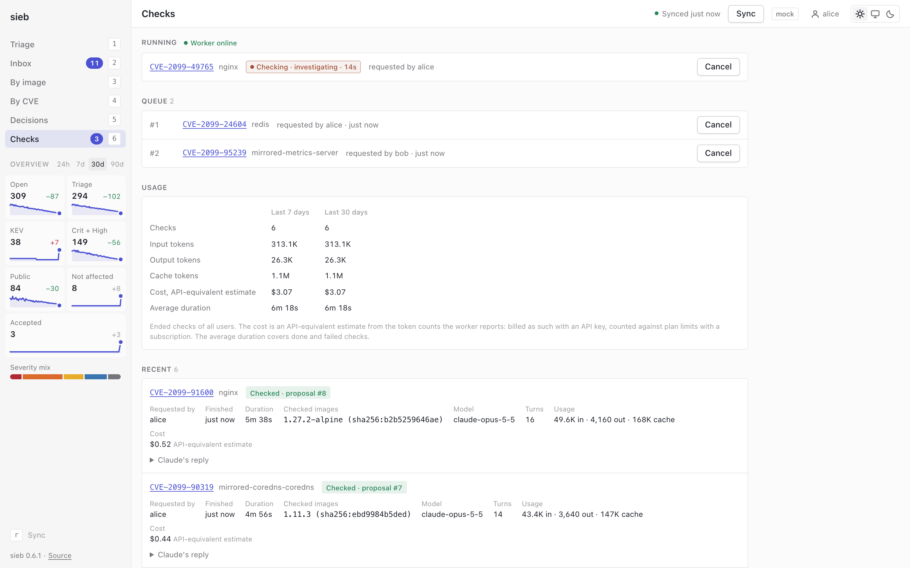
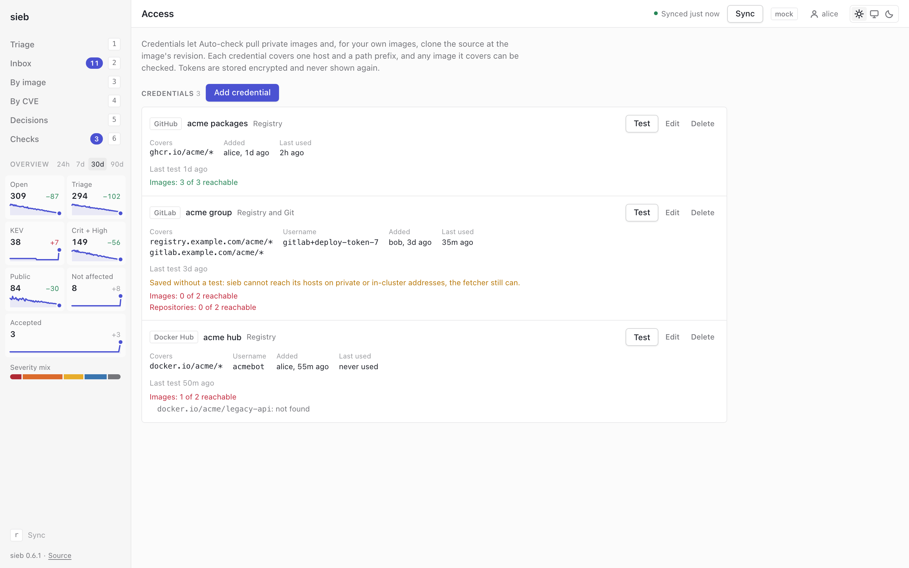

# Auto-check

This guide is for people who queue Auto-checks and for the operator who runs the worker. After
reading it you can queue a check, read its result, deploy the worker next to sieb and give it
read access to private images and source code.

Auto-check is optional and off by default. It needs the Claude integration, see
[Turn it on](working-with-claude.md#turn-it-on).

On this page

- [What it is](#what-it-is)
- [Using it](#using-it)
- [What a check can see](#what-a-check-can-see)
- [Set it up](#set-it-up)
- [Private access](#private-access)
- [Security model](#security-model)
- [Troubleshooting](#troubleshooting)

## What it is

An Auto-check is an unattended investigation of one finding by Claude. You queue the finding in
sieb. A separate worker in your cluster, `sieb-checker`, pulls the scanned image, unpacks it into
a throwaway workspace and runs headless Claude Code against it. Claude files its verdict as a
proposal, and you review it in the Inbox like any other proposal.

Nothing changes in sieb until a person accepts the proposal. The worker has no access to the
cluster: no service account, no Kubernetes API. It only reaches sieb, the registries, the git
hosts, Anthropic and a list of advisory sites.

Use it when you want a first investigation of many findings without sitting in a chat, and when
the answer is in the image: is the package there, is the vulnerable code compiled in, which base
image carries the fix. A question about the running workload still needs a person.

## Using it

### Queue a check

Open a finding and press **Auto-check** in the panel, or `Shift+C`. In Triage you can check
several rows and queue them all from the selection bar or with the same key. sieb sends a
selection in requests of at most 100 findings.

A toast tells you how many checks were queued and which findings were skipped, with the reason.
When the button cannot queue anything, it names the reason, see
[Troubleshooting](#troubleshooting).

A few rules decide what can be queued:

- The finding is open, and Auto-check can pull its image, anonymously or with a stored
  credential. [Ownership and visibility](triage.md#ownership-and-visibility) explains how sieb
  classifies an image.
- A finding has at most one open check.
- The queue holds at most 500 open checks. A selection that does not fit is not queued at all,
  and the button names the room left.
- The worker is online, which means it reached sieb within the last 90 seconds.

For one of your own images (owner `self`), sieb may not know yet whether the image can be pulled
anonymously. It then probes the registry when you queue, and waits a few seconds for the answer.
If the probe does not answer in time, the finding is skipped as "sieb could not probe yet". Try
again a minute later, or add a registry credential for the image.

### Follow it on the Checks page

The **Checks** page (key `6`) appears in the navigation while Auto-check is on, with the number
of open checks as a badge.

<picture><source media="(prefers-color-scheme: dark)" srcset="../.github/assets/screenshot-checks-dark.png"></picture>

It shows three things:

- The running check with its phase: preparing, investigating or reporting.
- The queue in the order the worker takes it. sieb runs one check at a time, oldest first.
- The 50 most recent ended checks with requester, duration, the checked images (tag and short
  digest), the source that was checked out, the model, turns, token usage, cost, the error of a
  failed check and Claude's reply as plain text.

Any signed-in user can cancel any queued or running check. sieb assumes one team that shares one
queue.

A failed or cancelled check that is the latest of its finding has a **Retry** action, on the
Checks page and in the finding panel. Retry queues the finding again under the same rules as a
new check.

When one of your own checks ends while sieb is open, a toast says so: done with a **Review**
action that opens the proposal, done without a proposal, or failed with its reason. Cancelled
checks and checks of other users stay silent.

### Review the result

A finished check leaves a proposal in the Inbox, marked as filed by Auto-check. You accept, edit
or reject it as described in [Review proposals](working-with-claude.md#review-proposals).

When the image does not settle the question, Claude files the verdict `inconclusive` and names
what it would need to decide. The review shows it as "Could not determine" and offers **Decide
myself**, **Re-check**, which queues a new check, and **Dismiss**. An inconclusive proposal never
becomes a decision on its own.

### Covered by a proposal

One root cause often produces several findings, and a proposal can list the others as related
findings. sieb skips a finding that an open proposal already lists this way, as "already covered
by proposal #N", with a link to that review. Queueing it again would spend a check on a question
that is already answered.

When every finding of your request is covered, the toast and the panel button offer **Check
anyway**, which queues them regardless. The finding a proposal targets directly is not affected.

### Usage and cost

The Usage section of the Checks page sums the ended checks of all users over the last 7 and 30
days: number of checks, input, output and cache tokens, cost and average duration.

The cost is the estimate Claude Code reports for each run. With an API key that is what you are
billed. With a subscription token it is the API-equivalent value of usage that counts against
your plan limits.

## What a check can see

A finding groups every tag of one image repository, and a decision covers all of them. The worker
therefore pulls each distinct digest among the open instances of the finding, at most three, most
recently seen first. Tags beyond that are named in the prompt, and Claude lists them as unknowns.
If sieb knows no digest at all, the worker pulls the most recently seen tag and tells Claude and
the Checks page that the content may differ from what was scanned.

Claude gets:

- The investigation prompt sieb builds from the finding.
- Per pulled image, the flattened filesystem for one platform, the image config (environment,
  entrypoint, labels, history) and a package inventory from syft.
- With [private access](#private-access), `source/`: the repository of the primary image, see
  [Which source a check gets](#which-source-a-check-gets).
- Read-only tools for files, binaries, archives and JSON, and two tools that read tags and
  metadata of public images, for example to see whether a base image tag was rebuilt after a fix.
- sieb's MCP tools, limited to the finding of the check, its CVE and its image, see
  [Auto-check tokens](reference/mcp.md#auto-check-tokens).
- Web pages on a list of advisory, distro, source and registry hosts, and web search. The list
  is in [Web access](reference/auto-check-internals.md#web-access).

Claude does not get a shell, a registry or git credential, a running container, the cluster,
images of other findings or files of the worker.

Without `source/`, the prompt names the reason, Claude lists the source under unknowns and must
not claim to have read it. A verdict that depends on how the image is deployed names the runtime
as not checked.

## Set it up

You need a sieb with the Claude integration on (`SIEB_MCP_ENABLED` and `SIEB_PUBLIC_URL`), a
Claude credential and room for one more pod in sieb's namespace. Use the same release for sieb
and the worker.

The worker image has two commands and runs as two containers in one pod. The fetcher pulls images
and checks out source. The checker runs Claude. The steps below set up this layout, because it
is the one that also supports private access later; [One container or two](#one-container-or-two)
describes the smaller alternative.

### 1. Turn it on in sieb

Generate two secrets, one for each container of the worker. They must differ, and each needs at
least 32 characters without whitespace.

```sh
openssl rand -hex 32
openssl rand -hex 32
```

The first is the worker secret, the second the fetcher secret. Both go into the worker's Secrets
of [step 3](#3-deploy-the-worker), `sieb-checker` and `sieb-fetcher`, and sieb reads them from
there, so each value lives in one place. Add these variables to the sieb container:

```yaml
env:
  - name: SIEB_CHECKS_ENABLED
    value: "true"
  - name: SIEB_WORKER_PORT
    value: "3101"
  - name: SIEB_WORKER_SECRET
    valueFrom:
      secretKeyRef:
        name: sieb-checker
        key: worker-secret
  - name: SIEB_FETCHER_SECRET
    valueFrom:
      secretKeyRef:
        name: sieb-fetcher
        key: fetcher-secret
```

Create the two Secrets before you apply the changed sieb Deployment, because a pod whose Secret
is missing does not start.

sieb then opens a second listener on the worker port that serves only the worker routes. Add the
port to sieb's Service and never route it through an Ingress:

```yaml
ports:
  - name: worker
    port: 3101
    targetPort: 3101
```

`SIEB_CHECK_TIMEOUT_SECONDS` (default 1200) and `SIEB_CHECK_MAX_TURNS` (default 60) limit one
check. All variables are in the
[configuration reference](reference/configuration.md), and
[Rules sieb enforces at start](reference/configuration.md#rules-sieb-enforces-at-start) lists
what sieb refuses.

### 2. Choose the Claude credential

The worker runs the unmodified Claude Code binary with one of two credentials. sieb never stores
either: you put it into a Secret that only the checker container mounts.

| Credential | Variable | Use it for |
| --- | --- | --- |
| API key from the [Claude Console](https://platform.claude.com/) | `ANTHROPIC_API_KEY` | Any shared or team deployment. Checks are billed per use to the key's organization |
| Subscription token from `claude setup-token` | `CLAUDE_CODE_OAUTH_TOKEN` | Only your own, individual use of your own deployment. Checks count against your plan limits |

`claude setup-token` runs on a machine with a browser and prints a one-year token that can only
make model requests. Do not run a worker with your subscription for other people's checks.
Anthropic's rules for both are in
[Authentication and credential use](https://code.claude.com/docs/en/legal-and-compliance.md#authentication-and-credential-use).

The checker refuses to start with neither or both, and with `ANTHROPIC_AUTH_TOKEN` set.

### 3. Deploy the worker

Apply these manifests in sieb's namespace. Adapt the release, the resources and the name of the
sieb Service. With a subscription token, store it under another key and set
`CLAUDE_CODE_OAUTH_TOKEN_FILE` in place of `ANTHROPIC_API_KEY_FILE`.

```yaml
apiVersion: v1
kind: Secret
metadata:
  name: sieb-checker
  namespace: sieb
type: Opaque
stringData:
  worker-secret: <worker secret from step 1>
  anthropic-api-key: <API key>
  local-secret: <openssl rand -hex 32>
---
apiVersion: v1
kind: Secret
metadata:
  name: sieb-fetcher
  namespace: sieb
type: Opaque
stringData:
  fetcher-secret: <fetcher secret from step 1>
  local-secret: <same value as local-secret in sieb-checker>
---
apiVersion: apps/v1
kind: Deployment
metadata:
  name: sieb-checker
  namespace: sieb
spec:
  replicas: 1
  strategy:
    type: Recreate
  selector:
    matchLabels:
      app.kubernetes.io/name: sieb-checker
  template:
    metadata:
      labels:
        app.kubernetes.io/name: sieb-checker
    spec:
      automountServiceAccountToken: false
      enableServiceLinks: false
      shareProcessNamespace: false
      terminationGracePeriodSeconds: 60
      securityContext:
        runAsNonRoot: true
        fsGroup: 1000
        seccompProfile:
          type: RuntimeDefault
      containers:
        - name: fetcher
          image: ghcr.io/bernhardkelm/sieb-checker:<version>
          args:
            - src/checker/fetcher/fetcherMain.ts
          env:
            - name: SIEB_WORKER_URL
              value: http://sieb.sieb.svc:3101
            - name: SIEB_FETCHER_SECRET_FILE
              value: /run/secrets/sieb-fetcher/fetcher-secret
            - name: SIEB_FETCHER_LOCAL_SECRET_FILE
              value: /run/secrets/sieb-fetcher/local-secret
          resources:
            requests:
              cpu: 100m
              memory: 256Mi
            limits:
              cpu: "1"
              memory: 1Gi
          securityContext:
            runAsUser: 1001
            runAsGroup: 1000
            allowPrivilegeEscalation: false
            readOnlyRootFilesystem: true
            capabilities:
              drop:
                - ALL
          volumeMounts:
            - name: shared
              mountPath: /shared
            - name: fetcher-work
              mountPath: /work
            - name: fetcher-secrets
              mountPath: /run/secrets/sieb-fetcher
              readOnly: true
        - name: checker
          image: ghcr.io/bernhardkelm/sieb-checker:<version>
          env:
            - name: SIEB_WORKER_URL
              value: http://sieb.sieb.svc:3101
            - name: SIEB_WORKER_SECRET_FILE
              value: /run/secrets/sieb-checker/worker-secret
            - name: ANTHROPIC_API_KEY_FILE
              value: /run/secrets/sieb-checker/anthropic-api-key
            - name: SIEB_FETCHER_URL
              value: http://127.0.0.1:3102
            - name: SIEB_FETCHER_LOCAL_SECRET_FILE
              value: /run/secrets/sieb-checker/local-secret
          resources:
            requests:
              cpu: 250m
              memory: 1Gi
            limits:
              cpu: "2"
              memory: 3Gi
          securityContext:
            runAsUser: 1000
            runAsGroup: 1000
            allowPrivilegeEscalation: false
            readOnlyRootFilesystem: true
            capabilities:
              drop:
                - ALL
          volumeMounts:
            - name: shared
              mountPath: /shared
              readOnly: true
            - name: checker-work
              mountPath: /work
            - name: checker-secrets
              mountPath: /run/secrets/sieb-checker
              readOnly: true
      volumes:
        - name: shared
          emptyDir:
            sizeLimit: 12Gi
        - name: fetcher-work
          emptyDir:
            sizeLimit: 1Gi
        - name: checker-work
          emptyDir:
            sizeLimit: 1Gi
        - name: fetcher-secrets
          secret:
            secretName: sieb-fetcher
            defaultMode: 0400
        - name: checker-secrets
          secret:
            secretName: sieb-checker
            defaultMode: 0400
```

Things to keep when you adapt it:

- Run one replica. sieb runs one check at a time.
- Each container mounts only its own Secret and its own work volume. Do not share one Secret
  through `envFrom`: each container refuses to start when it holds a secret of the other.
- The two containers run as different users (1001 and 1000) with the same group, and
  `shareProcessNamespace` stays off. That is what keeps the registry and git logins away from
  the container that runs Claude.
- The shared volume holds one check at a time: its image filesystems up to
  `SIEB_CHECKER_IMAGE_MAX_BYTES` (4 GiB by default) plus up to twice
  `SIEB_CHECKER_SOURCE_MAX_BYTES` (512 MiB by default) while source is checked out. Size it
  above the caps. When a volume runs full, the kubelet evicts the pod and sieb fails the check
  after the missing heartbeats.
- Run the pod on nodes that match `SIEB_CHECKER_PLATFORM` (`linux/amd64` by default).

The worker settings, such as the model, the effort level and the web host list, are in the
configuration reference under [Checker container](reference/configuration.md#checker-container)
and [Fetcher container](reference/configuration.md#fetcher-container).

### 4. Add the NetworkPolicy

The policy is required, not a hardening extra. The list of web hosts Claude may fetch is a rule
inside Claude Code, not a network boundary. A tool that is exploited through a crafted image file
could otherwise reach internal services and the cloud metadata endpoint.

The worker accepts no connections. It needs DNS, sieb's worker port and HTTPS to the registries,
the git hosts, Anthropic, the advisory sites and sieb's public URL, which carries the MCP
endpoint. Everything private stays closed: RFC 1918, the shared address space `100.64.0.0/10`
and link-local `169.254.0.0/16`.

```yaml
apiVersion: networking.k8s.io/v1
kind: NetworkPolicy
metadata:
  name: sieb-checker
  namespace: sieb
spec:
  podSelector:
    matchLabels:
      app.kubernetes.io/name: sieb-checker
  policyTypes:
    - Ingress
    - Egress
  egress:
    - to:
        - namespaceSelector:
            matchLabels:
              kubernetes.io/metadata.name: kube-system
          podSelector:
            matchLabels:
              k8s-app: kube-dns
      ports:
        - port: 53
          protocol: UDP
        - port: 53
          protocol: TCP
    - to:
        - podSelector:
            matchLabels:
              app.kubernetes.io/name: sieb
      ports:
        - port: 3101
    - to:
        - ipBlock:
            cidr: 0.0.0.0/0
            except:
              - 10.0.0.0/8
              - 172.16.0.0/12
              - 192.168.0.0/16
              - 100.64.0.0/10
              - 169.254.0.0/16
      ports:
        - port: 443
          protocol: TCP
```

If sieb's public URL, a self-hosted GitLab or a registry resolves to an address inside the
cluster or your network, for example the ingress controller, also allow that address on port 443.

sieb's own policy needs one more ingress rule that admits the worker on port 3101. The rule and
the rest of that policy are in [NetworkPolicy](deployment.md#networkpolicy).

### 5. Check that it works

Open the Checks page. It says whether the worker is online. Queue a finding on a public image and
watch it move through preparing, investigating and reporting.

sieb's `/metrics` exports the open checks per state, the ended checks per status, their run time
and whether the worker is online. [Auto-check alerts](prometheus-rules.md#auto-check-alerts) has
example alerts for an offline worker and a queue that does not move.

## Private access

Out of the box, a check covers images that can be pulled anonymously, and source code in public
repositories on github.com and gitlab.com. Private access adds read credentials for GitHub,
GitLab (gitlab.com or self-hosted) and Docker Hub, so a check can also pull private images and
clone private repositories.

### What leaves your cluster

Decide this before you store the first credential.

During an Auto-check, Claude reads the private images and the source code these credentials
reach. What Claude reads is sent to Anthropic, like the rest of the check. Web requests and search
queries Claude makes during the check can carry fragments of it to the hosts on the web list, see
[Security model](#security-model).

Only add credentials for code your organization allows to share with Claude. Scope each one with
a path prefix and a read-only token, as described below.

There is no separate allow list of images. Every image a stored registry credential covers can be
queued by any signed-in user.

### Turn it on

Private access needs the two-container worker from [Set it up](#set-it-up), with
`SIEB_FETCHER_SECRET` on sieb and the fetcher. It needs one more secret on sieb, the key that
seals the stored credentials: 32 random bytes in base64.

```sh
openssl rand -base64 32
```

Mount it into the sieb container as a file and point `SIEB_CREDENTIALS_KEY_FILE` at it, or pass
it as `SIEB_CREDENTIALS_KEY`. Setting both is refused, and a malformed key refuses to start.

sieb stores each credential sealed with AES-256-GCM under this key. The database alone does not
reveal a token, the database together with the key does. Keep the key in a Secret apart from
backups of the database volume. sieb cannot re-encrypt: with a new key every stored token has to
be entered again, see [Secrets and rotation](operations.md#secrets-and-rotation).

Which container holds which secret:

| Secret | sieb | Fetcher | Checker |
| --- | --- | --- | --- |
| Credentials key | yes | no | no |
| Stored registry and git tokens | sealed | per check, for the pull and the clone | never |
| `SIEB_FETCHER_SECRET` | yes | yes | refused |
| `SIEB_WORKER_SECRET` | yes | refused | yes |
| Local secret between the two containers | no | yes | yes |
| Claude credential | no | refused | yes |

Claude runs in the checker, so it never holds a registry or git token.

### Add a credential

Signed-in users manage credentials on the **Access** page, in the user menu while Auto-check is
on. Any signed-in user can add, change, test and delete any credential.

<picture><source media="(prefers-color-scheme: dark)" srcset="../.github/assets/screenshot-access-dark.png"></picture>

A credential has a provider, a label, one or both uses (**Registry** to pull images, **Git** to
clone source), the hosts and a path prefix. Create the token with the least access the provider
offers:

| Provider | Token | Access |
| --- | --- | --- |
| GitHub, source code | Fine-grained personal access token | Only select repositories, Contents: Read-only |
| GitHub, packages (`ghcr.io`) | Personal access token (classic) | Only the `read:packages` scope |
| GitLab | Group or project deploy token | Scopes `read_registry` and `read_repository`, plus the username GitLab shows |
| Docker Hub | Personal access token | Access permissions Read-only, plus your Docker Hub username |

Fine-grained GitHub tokens do not work with GitHub Packages. For the least access on GitHub, add
two credentials: the fine-grained token with the use Git, and the classic token with the use
Registry. A GitLab deploy token covers registry and git in one credential.

sieb tests a token before it stores it. **Test and save** tries the token on the images and
repositories it covers. It saves only when, for each use, at least one target was reachable and
none refused the login. A single image that has moved on does not block the save. If the test
fails, the form stays open with the result per use, and the token stays in its field. **Test
only** runs the same test without saving.

Three cases behave differently:

- A prefix that covers no image or repository sieb has seen cannot prove the token, so the save
  is refused. Fix the prefix or the mapping.
- A host on a private or in-cluster address is never contacted by sieb. The form then offers to
  save without a test, because the fetcher can still reach the host. The list marks such a
  credential as saved without a test.
- Changing only the label saves without a test.

Tokens are write-only. The token field is never prefilled, and sieb never shows a stored token
again. Changing the provider or adding a host asks for the token again, so a stored token never
goes to a host it was not entered for.

The list shows for each credential what it covers, who added it, when it was last used and the
last test. **Test** runs the test again on a stored credential. When you delete a credential,
revoke the token at the provider too.

The test runs in sieb itself, so sieb's pod needs HTTPS egress to the registries and git hosts of
your credentials, see [NetworkPolicy](deployment.md#networkpolicy). The address rules of the test
are in [Access credentials](reference/api.md#access-credentials).

### Path prefix and repository mapping

The path prefix limits a credential to part of its hosts. It matches whole path segments: the
prefix `acme` covers `ghcr.io/acme/*` and `github.com/acme/*`, an empty prefix covers the whole
host. When several credentials cover a target, the longest prefix wins.

To check out source, sieb has to know which repository an image was built from. It looks in
three places, in this order:

1. The image's own `org.opencontainers.image.source` label.
2. An explicit repository mapping on a credential. It swaps a registry prefix for a repository
   prefix: `registry.example.com/acme/` to `gitlab.example.com/acme/` maps the image
   `registry.example.com/acme/shop` to the repository `gitlab.example.com/acme/shop`.
3. The default mapping of the provider. GitHub maps `ghcr.io/<owner>/<name>` to
   `github.com/<owner>/<name>`. GitLab maps `<registry host>/<path>` to `<git host>/<path>`, and
   for a nested image name such as `group/project/image` it tries the longest path first, at
   most three candidates.

Details that decide edge cases:

- A source label counts only when its repository has the same owner as the image, which is the
  first path segment. A label inherited from a base image of another owner never picks the
  repository.
- An explicit mapping stays within its credential's hosts and path prefix, applies only to
  images that credential covers, and needs a git credential for the repository.
- The default mapping applies to a credential that has both uses and no explicit mapping.
- One of your own images on `ghcr.io` or `registry.gitlab.com` gets the default mapping without
  any credential. A public repository then needs no setup and no build label.
- Docker Hub has no git host, so its images get their source from the label alone.

### Which source a check gets

A repository that a git credential covers is cloned with that credential. Without one, the
fetcher clones anonymously, but only from github.com, gitlab.com or the git host of a stored
credential. If the anonymous clone fails, the repository is private: store a git credential for
it.

The fetcher then picks the commit:

1. The commit in the image's `org.opencontainers.image.revision` label.
2. The git tag that matches the image tag: `<tag>`, then `v<tag>`. Not for `latest` and not for
   an image known only by digest.
3. The default branch, which may differ from the code the image was built from.

The Checks page shows the result as Source: the repository with the short commit, "at tag
v1.4.2" when a git tag was used, or "default branch". Claude is told the same, so it can weigh a
default branch checkout accordingly. Set the two labels in your image build to get the exact
commit.

In the finding panel, the fact **Auto-check access** says per image whether the check reaches it:
Public, Via the covering credential, or No access with a link to the Access page.

### Self-hosted GitLab or registry

For a self-hosted GitLab, set both hosts on the credential, such as `registry.gitlab.example.com`
and `gitlab.example.com`.

If the host uses a certificate from a private CA, mount the CA certificate into the fetcher. The
tools that pull and clone run with a stripped environment, so `SSL_CERT_FILE` and
`GIT_SSL_CAINFO` on the container do not reach them. They do find a certificate in the system
directory under its hash name. Compute the name:

```sh
openssl x509 -hash -noout -in ca.crt
```

Store the certificate in a ConfigMap `sieb-ca` under the key `ca.crt`, then add the mount to the
fetcher container and the volume to the pod:

```yaml
containers:
  - name: fetcher
    volumeMounts:
      - name: ca
        mountPath: /etc/ssl/certs/<hash>.0
        subPath: ca.crt
        readOnly: true
volumes:
  - name: ca
    configMap:
      name: sieb-ca
```

Fetching one commit by its id needs Git protocol v2, which GitLab and GitHub serve, or
`uploadpack.allowReachableSHA1InWant` on an older server. Without it the fetcher falls back to
the git tag and then to the default branch.

sieb's own credential test and its pull probe refuse private and in-cluster addresses. A registry
on such an address cannot be tested or probed from sieb, so its own images stay "unknown" until a
registry credential covers them. The fetcher still uses the credential.

### One container or two

Run two containers whenever sieb has `SIEB_FETCHER_SECRET` or stored credentials.

The single-container layout is the smaller alternative when every image you check is public and
no check needs a source checkout. Drop the fetcher container with its Secret and volumes, drop
`SIEB_FETCHER_URL` and `SIEB_FETCHER_LOCAL_SECRET_FILE` from the checker, mount only the work
volume, and leave `SIEB_FETCHER_SECRET` off sieb. The checker then pulls images itself,
anonymously, and checks out no source.

The worker layout does not change what sieb queues. With private access on in sieb and a
single-container worker, checks of private images are queued, claimed and then fail with "the
image needs a registry credential, which only the fetcher container uses".

## Security model

The image under investigation is untrusted input. Its files can contain text written to steer
Claude, and its binaries can be crafted to attack the tools that read them. The design keeps what
a steered Claude can reach small:

- Claude has no shell and cannot write files. It reads the workspace, calls a fixed set of
  read-only inspection tools and fetches web pages from a list of hosts.
- Claude's access to sieb is a short-lived token bound to the one finding of the check. With it
  Claude can file a proposal, which changes nothing until a person accepts it.
- Registry and git tokens exist only in the fetcher container, only for the running check. The
  container that runs Claude cannot read them.
- The Claude credential is handed to Claude Code on a file descriptor, not in its environment or
  on its command line.
- The pod has no service account token, a read-only root filesystem, no capabilities and a
  NetworkPolicy that closes every private address.

Limits you should know before you decide what to connect:

- The web host list narrows exfiltration, it does not close it. A steered Claude can put what it
  read into the path or query of a request to an allowed host, such as a GitHub URL, or into a
  search query. With private access, what it read includes your private images and source code.
  Shorten the list with `SIEB_CHECKER_WEB_DOMAINS` to tighten this.
- Everything Claude reads is sent to Anthropic. That is how the check works.
- Inside one container every process runs as the same user. A memory corruption bug in one of
  the parsers, triggered by a crafted image file, could read the secrets that container holds.
  Keep the worker image current.
- Claude's reply is shown as untrusted plain text. Read a proposal's evidence before you accept
  it.

[Auto-check internals](reference/auto-check-internals.md) describes each of these mechanisms for
a security review.

## Troubleshooting

### The button does not queue

| What the button or toast says | Cause | What to do |
| --- | --- | --- |
| Auto-check is not switched on for this sieb | `SIEB_CHECKS_ENABLED` is off | [Set it up](#set-it-up) |
| The Auto-check worker is offline | No worker request for 90 seconds | Look at the worker pod and its logs, the worker secret and the NetworkPolicy |
| No credential covers this image's registry | The image cannot be pulled anonymously and no registry credential covers it | Add a credential on the Access page |
| The finding is resolved | The scanner no longer reports it | Nothing left to check |
| Claude is checking this finding right now, or a check is already queued | One open check per finding | Wait for it or cancel it on the Checks page |
| Already covered by proposal #N | An open proposal lists the finding as related | Review that proposal, or **Check anyway** |
| The queue is full, or holds at most 500 checks | 500 open checks are the limit | Select fewer findings or wait |
| Skipped: with an image sieb could not probe yet | The pull probe of an own image timed out, was rate limited or failed | Try again in a minute, or add a registry credential |

sieb starts at most 10 probes per minute. A registry on a private or in-cluster address is never
probed, so its images always need a registry credential.

### A check failed

The Checks page shows the error of a failed check. The common ones:

| Error | Cause | What to do |
| --- | --- | --- |
| Timed out: the worker sent no heartbeat for 120 seconds | The worker pod died or lost sieb during the check | Look for an eviction (full volume, memory limit) and at the worker port |
| Timed out: the check ran longer than N seconds | The check passed `SIEB_CHECK_TIMEOUT_SECONDS` | Retry, or raise the timeout |
| Claude timed out, or Claude reached the turn limit | The investigation did not finish in time or turns | Retry, or raise `SIEB_CHECK_TIMEOUT_SECONDS` or `SIEB_CHECK_MAX_TURNS` |
| image pull failed | The registry did not serve the image | Read the registry's message after the colon; a deleted tag cannot be checked |
| the image needs a registry credential, which only the fetcher container uses | Single-container worker and a private image | Run [two containers](#one-container-or-two) |
| the registry refused the login of credential '...' | The stored token expired, was revoked or lacks access | Test the credential on the Access page and enter a new token |
| the image is no longer pullable | sieb no longer knows a digest or tag of the finding | Wait for the next scan |
| The image is no longer public or covered by a registry credential | Access changed between queueing and the start | Check the credential, then Retry |
| image export exceeds 4 GiB (your cap) | The primary image is larger than `SIEB_CHECKER_IMAGE_MAX_BYTES` | Raise the cap and the shared volume |
| the fetcher is unreachable, or the shared workspace is not readable | The two containers do not fit together | Compare the local secret, `SIEB_FETCHER_URL`, the group and the shared mount with the manifests |
| cancelled or timed out in sieb | Someone cancelled the check | Retry if you still want it |
| worker stopped | The pod was terminated during the check, for example by a rollout | Retry |

A check that is done but has no proposal means Claude ended without filing one. Its reply on the
Checks page usually says why.

A check without source is not a failure. The prompt tells Claude why `source/` is missing, and
the proposal lists the source under unknowns. The usual causes are a missing source label and
mapping, a private repository without a git credential, or a checkout above
`SIEB_CHECKER_SOURCE_MAX_BYTES`.

If the worker does not start at all, its log names the variable it refuses. The operator side of
this is in [Troubleshooting](operations.md#troubleshooting).

## See also

- [Review proposals](working-with-claude.md#review-proposals) for what to do with the result of
  a check.
- [Auto-check internals](reference/auto-check-internals.md) for how a check runs and the full
  security model.
- [Checks](reference/api.md#checks) and [Access credentials](reference/api.md#access-credentials)
  for the routes.
- [Running the Auto-check worker locally](../CONTRIBUTING.md#running-the-auto-check-worker-locally)
  for development.
