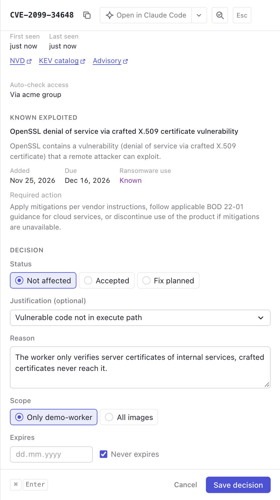
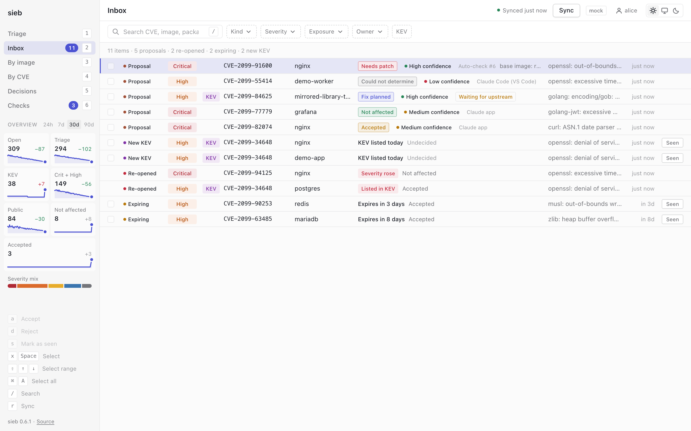

# Triage

This guide is for the person who works through the findings in sieb. After reading it you can
decide a finding, tell which decisions silence an alert, and find your way around the views, the
Inbox, the filters and the keyboard shortcuts.

On this page

- [The idea](#the-idea)
- [A first walk through](#a-first-walk-through)
- [Findings](#findings)
- [Decisions](#decisions)
- [Expiry and re-opening](#expiry-and-re-opening)
- [How decisions mute alerts](#how-decisions-mute-alerts)
- [The views](#the-views)
- [The Inbox](#the-inbox)
- [Filters and search](#filters-and-search)
- [Exposure and owner](#exposure-and-owner)
- [Ownership and visibility](#ownership-and-visibility)
- [Bulk actions and selection](#bulk-actions-and-selection)
- [Keyboard shortcuts](#keyboard-shortcuts)
- [With Claude](#with-claude)

## The idea

A finding is one vulnerability in one image. A decision records what you concluded about it: not
affected, accepted or fix planned, with a reason.

A decision is in effect while it is not revoked, not expired and not re-opened. A not affected or
accepted decision in effect silences the alerts of its findings. The findings stay visible in sieb
and in your dashboards, only the alert goes quiet.

When the facts change, sieb brings the finding back: a decision expires on its date, and it
re-opens when a finding gets more severe or becomes KEV listed.

## A first walk through

1. Open **Triage**. It lists the open findings that still need a decision, the most pressing
   first.
2. Click a row, or move to it with `j` and `k` and press `Enter`. The finding panel opens beside
   the list.
3. Read the panel: the advisory, the KEV details if the CVE is known to be exploited, the
   workloads that run the image, and where Trivy found the package.
4. Choose a status in the decision form, write the reason and save with the button or with
   `Cmd+Enter` (`Ctrl+Enter` outside macOS).

The finding leaves Triage. If you chose not affected or accepted, its alert stops within about two
minutes.

<picture><source media="(prefers-color-scheme: dark)" srcset="../.github/assets/screenshot-panel-dark.png"></picture>

## Findings

One finding is one vulnerability id (a CVE, a GHSA and so on) in one image, named by registry and
repository without a tag. An image that runs in five workloads still gives one finding per CVE.
The panel lists the workloads, containers and package versions under it.

sieb reads the findings from Prometheus and from the `VulnerabilityReport` resources of the Trivy
Operator. It syncs on a schedule (every 15 minutes by default), and `r` or the sync control starts
a sync right away. A finding that Trivy no longer reports is resolved and leaves the lists.

Triage ranks findings in this order: KEV listed first, then exposure, then severity, then score.
Click a column header to sort by that column instead.

A finding carries a **new** tag while sieb first saw it within the last 7 days and you have not
looked at it. The tag goes away once the finding has been open in the panel for two seconds, or
when you act on it. **Mark all as seen** above the list clears the tag for the whole filtered
list. The tag is per user.

For a KEV listed finding the panel shows the entry of the CISA Known Exploited Vulnerabilities
catalog: date added, due date, known ransomware use and the required action. These details need
the `cisa` KEV source, see [KEV source](deployment.md#kev-source).

**Found in** lists the files in which Trivy found the package, for example a Go binary or a
lockfile. The Trivy Operator reports these paths only with an extra setting, see
[What you need](getting-started.md#what-you-need).

## Decisions

A decision has a status, a scope and a reason. The status decides what happens to the finding:

| Status | Leaves Triage | Silences alerts | Stays in the risk counts | Default expiry |
| --- | --- | --- | --- | --- |
| Not affected | yes | yes | no | none |
| Accepted | yes | yes | yes | 90 days |
| Fix planned | yes | no | yes | none |

Use not affected when the vulnerability cannot be exploited in this image, accepted when it can
but you take the risk for a while, and fix planned when a fix is on its way and you still want the
alert. The risk counts are the open counts of the By image view, see [The views](#the-views).

### Scope

**This image** decides the CVE for one image. **All images** decides it for every image the CVE is
found in, including images where it shows up later. A new image is covered from the next sync on.

A decision for one image wins over a decision for all images of the same CVE. This holds even when
the image decision is expired or re-opened: that image is then back in Triage while the others
stay decided. Revoke the image decision to let the one for all images apply again.

### Reason, justification and expiry

The reason is required and holds up to 2000 characters. Write it for the person who reviews the
decision in three months.

A not affected decision can carry an OpenVEX justification, such as **Component not present (false
positive)** or **Vulnerable code not in execute path**. It is optional and informational: a not
affected decision behaves the same with or without one.

The expiry is a date or **Never expires**. An accepted decision suggests 90 days, the other
statuses suggest no expiry, and you can change either. A date lies at most three years ahead and
counts until the end of that day.

### Waiting for upstream

A fix planned decision can be marked **Waiting for upstream** when no fixed release exists yet.
Name the release or image you wait for, and set the expiry to the date on which you want to look
again. The Decisions view has a tab for these decisions, and Triage has a filter.

## Expiry and re-opening

An expired decision is no longer in effect. Its findings return to Triage and their alerts can
fire again. Edit the decision and save a new date to put it back in effect. A decision that
expires within 14 days shows in the Inbox, so you can extend it before it lapses.

A decision re-opens when one of its open findings gets a higher severity than it had when you
decided, or becomes KEV listed after you decided. A decision for all images re-opens as a whole
when this happens in one image. It stays re-opened even if the severity drops again, because
somebody should look at it.

To handle a re-opened decision, choose one of these:

- Re-confirm it. The decision is back in effect and takes the current severity and KEV listing as
  its new baseline. Use **Re-confirm** in the Decisions view, or tick the re-confirm box when you
  edit the decision.
- Edit it, for example from accepted to fix planned. An edit without re-confirming keeps the
  decision re-opened.
- Revoke it. The findings return to Triage for a fresh decision.

Revoking takes an optional comment and cannot be undone. Decide the finding again if you change
your mind.

The finding panel shows the history of every decision on the finding: who decided, what changed,
and when sieb expired or re-opened it.

## How decisions mute alerts

sieb exports one `sieb_suppressed` series for every open finding whose decision silences alerts.
That is a not affected or accepted decision in effect. Fix planned never silences, and neither
does a revoked, expired or re-opened decision.

Your Prometheus rules subtract these series from the findings, and your alerts read what is left.
sieb does not talk to Alertmanager and creates no silences there.

| Event | Effect on the alert |
| --- | --- |
| You decide not affected or accepted | Silenced within 1 to 2 minutes. A pending alert does not fire, a firing alert resolves |
| A decision is revoked, expires or re-opens | The finding counts again within 1 to 2 minutes, and the alert fires after its `for` duration |

The delay is one scrape of sieb plus one rule evaluation. If sieb is down, Prometheus keeps the
last set of silenced findings for up to 6 hours. The rules and the full timing table are in
[Silencing alerts](prometheus-rules.md#silencing-alerts).

## The views

| View | Shows |
| --- | --- |
| Triage | Open findings that need a decision: undecided ones, and those whose decision expired or re-opened |
| Inbox | What waits for you, see [The Inbox](#the-inbox) |
| By image | One row per image with its open findings, a risk view |
| By CVE | One row per CVE with the images it is found in, a triage view |
| Decisions | Every decision, in tabs by state |
| Checks | The Auto-check queue and results, listed only while Auto-check is on |

### By image

By image answers "how exposed is this image". Its counts leave out findings decided not affected
and keep accepted and fix planned ones, because an accepted risk is still a risk. Turn on **Show
not affected** to count everything. Expand a row to see the findings of the image.

### By CVE

By CVE answers "what is left to decide for this CVE". A CVE whose open findings are all decided is
hidden until you turn on **Show decided**. An expanded CVE offers two actions: **Decide open
images** makes one decision per undecided image, and **Decide for all images** makes one decision
with the scope all images.

### Decisions

The tabs are Active, Expiring, Re-opened, Expired, Fix planned, Waiting for upstream and Revoked.
Expand a decision to read its reason and the findings it covers, and to edit, re-confirm or revoke
it. The search covers CVE, image, reason and author.

### Overview stats

The sidebar shows the counts of open findings: Open, Triage, KEV, Crit + High, Public, Not
affected and Accepted. Each has a trend over the last 24 hours, 7, 30 or 90 days. A click on a
stat opens the matching list. When Triage is empty, sieb shows an all clear state.

## The Inbox

The Inbox collects what changed and needs your attention, newest first. Its count shows as a badge
in the navigation.

| Kind | In the Inbox while | Leaves when |
| --- | --- | --- |
| Proposal | Claude filed a proposal that is still open | You accept or reject it |
| Re-opened | A decision is re-opened | You re-confirm or revoke it |
| Expiring | A decision in effect expires within 14 days | You extend it or mark it as seen |
| New KEV | An open finding became KEV listed within the last 14 days | You mark it as seen |

Proposals, re-opened decisions and new KEV listings are sorted by time, newest first. Expiring
decisions follow, the soonest first.

<picture><source media="(prefers-color-scheme: dark)" srcset="../.github/assets/screenshot-inbox-dark.png"></picture>

Open an item with `Enter`. A proposal opens its review, described in
[Review proposals](working-with-claude.md#review-proposals). The other kinds open the finding or
decision they are about.

**Mark as seen** (`s`) removes an expiring decision or a new KEV listing from your Inbox. Seen
marks are per user, so your colleague still has the item. Proposals and re-opened decisions cannot
be marked as seen. They leave when somebody handles them.

Check several proposals to accept or reject them together with `a` or `d`. A dialog shows what
will happen before anything is saved. The filter bar narrows the Inbox by kind, severity, exposure,
owner and KEV listing, and the search covers CVE, image, package and namespace.

Without Claude the Inbox holds the other three kinds.

## Filters and search

The search above Triage matches CVE, image, package and workload. `/` puts the cursor in it. Next
to it are these filters:

| Filter | Keeps |
| --- | --- |
| Severity | Findings of the chosen severities |
| Exposure | Findings of the chosen tiers, including Unknown |
| Owner | Findings of the chosen owners |
| Pending | Findings something waits on, see below |
| KEV | KEV listed findings |
| Waiting for upstream | Findings whose decision waits for an upstream release |
| New this week | Findings first seen within the last 7 days |
| Show resolved | Also the findings Trivy no longer reports |

**Pending** has the options Proposed (an open proposal), Re-opened (a re-opened decision), New KEV
(a new KEV listing in your Inbox), Checking (a queued or running Auto-check, offered while
Auto-check is on) and Untouched (none of these). Untouched is the list to start with when Claude
already works on the rest.

Filters and the sort order live in the address of the page. Copy the link to share exactly the
list you see. **Reset** clears all filters.

## Exposure and owner

Exposure and owner are optional labels that come from your own findings rule, see
[Findings query](prometheus-rules.md#findings-query). While no open finding carries a label, sieb
hides its column, filter and chip.

Exposure says how a workload can be reached from outside the cluster:

| Tier | Meaning |
| --- | --- |
| Public | Reachable from the internet with no gate in front. The app's own login does not count |
| Gated | A gate in front of the app, such as an SSO proxy or an IP allowlist, restricts who can reach it at all |
| Internal | No route from outside the cluster, reachable only from other pods and nodes |
| Unknown | No exposure label. Treat the workload as possibly reachable |

Triage ranks public first, then gated, then unknown, then internal. Unknown ranks above internal
on purpose: an unlabelled workload may be reachable.

Exposure describes the network entry only. It does not lower the risk of flaws triggered by
processed data, such as uploaded files or parsed archives.

Owner is a free-form label, for example a team name. Only the value `self` has a meaning to sieb:
it marks your own images, shows as **Own** and sorts first.

## Ownership and visibility

sieb keeps two facts about every image, shown as chips in the finding panel.

Ownership is either own or third-party. An image is your own when its owner label is `self`. The
owner chip then reads **Own**, as in the panel header. Where no owner chip is shown, an **Own
image** chip marks it instead.

Visibility says whether the image can be pulled:

| Visibility | Meaning | Chip |
| --- | --- | --- |
| Public | Anyone can pull it without a login | Public image for an own image, none for a third-party one |
| Credential | A private image that a registry credential stored in sieb covers. Auto-check pulls it with that credential | Private · credential |
| Restricted | An anonymous pull was refused and no credential covers it | Not pullable |
| Unknown | Not known yet | none |

A third-party image on a well-known public registry counts as public. For an own image, sieb asks
the registry whether an anonymous pull would be allowed. It does this when you open the finding,
and it downloads nothing.

The two facts matter once Claude is involved. Auto-check can only investigate an image it can
pull, so public and credential images qualify and restricted ones do not until you add a
credential, see [Private access](auto-check.md#private-access). For an own image, the hand-off
also offers a `claude` command to run in the repository of that image on your machine. The exact
rules are in [Image access](reference/api.md#image-access).

## Bulk actions and selection

Triage and the Inbox let you check several rows and act on all of them.

- `x` or `Space` checks the row under the cursor, and so does a click on its checkbox.
- `Shift` with the arrow keys, or a `Shift` click, checks a range.
- `Cmd+A` (`Ctrl+A` outside macOS) checks every row of the filtered list, and a `Cmd` or `Ctrl`
  click toggles one row.
- `Esc` clears the selection.

In Triage, `a`, `n` or `f` then opens one dialog that decides all checked findings as accepted,
not affected or fix planned. A bulk decision makes one decision per image and covers at most 200
images. `Shift+A` opens the same dialog without a status chosen. With no row checked it offers
every open image of the CVE under the cursor.

In the Inbox, the checked proposals can be accepted or rejected together, and checked expiring and
KEV items can be marked as seen.

An unsaved decision in the panel is protected: sieb asks before a click on another row, a
navigation or closing the tab discards it.

## Keyboard shortcuts

Shortcuts work while the cursor is not in a text field and no dialog is open. The sidebar lists
the shortcuts of the current view, and each entry there can be clicked.

Everywhere

| Key | Action |
| --- | --- |
| `1` to `5` | Triage, Inbox, By image, By CVE, Decisions |
| `6` | Checks, while Auto-check is on |
| `j` `k` or `↓` `↑` | Move the cursor |
| `PageDown` `PageUp`, `Home` `End` | Move a page, jump to the first or last row |
| `Enter` or `o` | Open the row |
| `Esc` | Close the panel |
| `/` | Search |
| `r` | Sync |

Triage and the finding panel

| Key | Action |
| --- | --- |
| `a` `n` `f` | Decide as accepted, not affected, fix planned |
| `x` or `Space` | Check the row |
| `Shift+↓` `Shift+↑` | Check a range |
| `Cmd+A` or `Ctrl+A` | Check all rows |
| `Shift+A` | Open the bulk dialog |
| `Cmd+Enter` or `Ctrl+Enter` | Save the decision form |

With Claude connected, `Shift+H` opens the finding in Claude, `h` copies the prompt and `y` copies
the `claude` command. With Auto-check on, `Shift+C` queues a check. All four act on the checked
rows when there are any.

Inbox

| Key | Action |
| --- | --- |
| `a` | Accept the checked proposals |
| `d` | Reject the checked proposals |
| `s` | Mark as seen |
| `x` or `Space`, `Shift+↓` `Shift+↑`, `Cmd+A` or `Ctrl+A` | Check rows, as in Triage |
| `Cmd+Enter` or `Ctrl+Enter` | Accept the proposal in the open review |

By image, By CVE and Decisions

| Key | Action |
| --- | --- |
| `→` `←` | Expand or collapse a row |
| `Shift+A` | By CVE: decide open images |
| `Shift+D` | By CVE: decide all images |
| `o` | Decisions: open the finding |
| `e` | Decisions: edit |
| `c` | Decisions: re-confirm |
| `Backspace` or `Delete` | Decisions: revoke |

On a phone the navigation moves to a tab bar at the bottom, and a selection bar with the bulk
actions appears once a row is checked.

## With Claude

Claude is optional and off by default. Once an operator turns it on, the finding panel gains a
hand-off button and, with Auto-check, a button that queues an unattended check. Claude files what
it finds as a proposal in your Inbox. A proposal changes nothing until you accept it, and you can
edit it first.

## See also

- [Working with Claude](working-with-claude.md): connect Claude, hand off a finding, review
  proposals
- [Auto-check](auto-check.md): unattended checks inside the cluster
- [Prometheus rules](prometheus-rules.md#silencing-alerts): the rules that make decisions silence
  alerts
- [HTTP API](reference/api.md#decisions): the same decisions over the API
