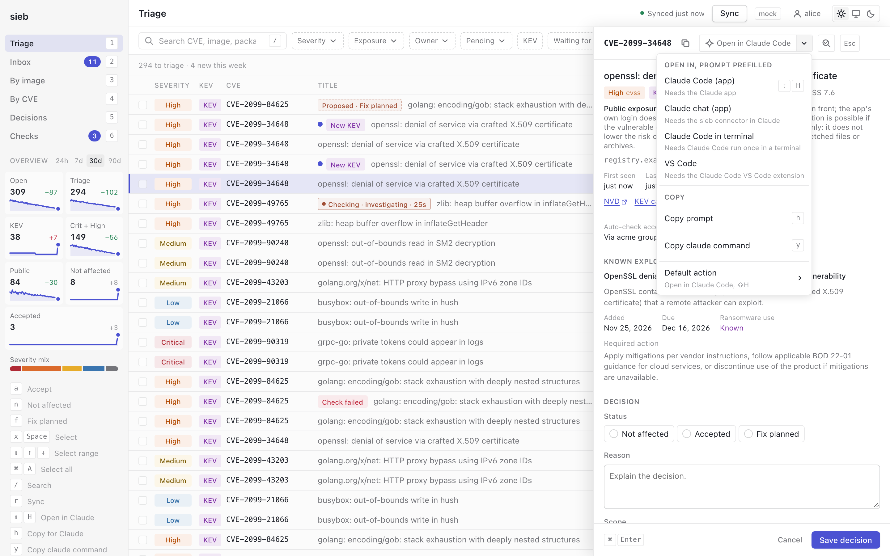
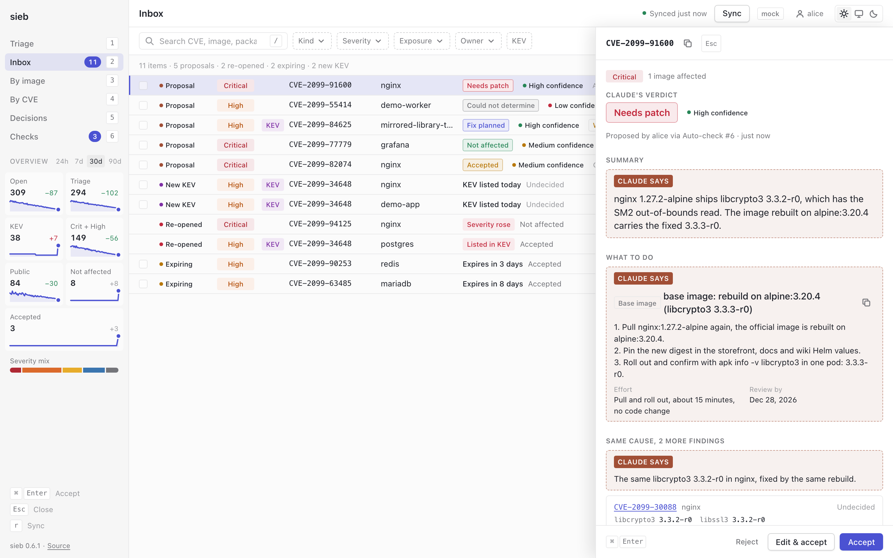

# Working with Claude

This guide is for people who triage with sieb and for the operator who connects Claude to it. After
reading it you can connect Claude, ask it about your findings, hand a finding over for
investigation and review what Claude proposes.

Triage with Claude is optional and off by default. Everything in [Triage](triage.md) works without
it.

On this page

- [What you get](#what-you-get)
- [Turn it on](#turn-it-on)
- [Connect](#connect)
- [Ask questions](#ask-questions)
- [Hand off a finding](#hand-off-a-finding)
- [Review proposals](#review-proposals)
- [The reply format](#the-reply-format)
- [Security in short](#security-in-short)

## What you get

sieb serves a [Model Context Protocol](https://modelcontextprotocol.io) (MCP) endpoint at `/mcp`.
Through it Claude reads what sieb knows: findings, images, decisions, KEV details and the overview.
You ask in plain language, in claude.ai, the Claude app or Claude Code.

With propose access, Claude also files its verdict on a finding as a proposal with evidence. A
proposal is a suggestion that waits in your Inbox. Nothing changes until a person accepts it: no
decision is written, no alert is silenced, and `/metrics` and the stats stay as they are.

Claude cannot create, change, revoke or accept decisions, run a sync or manage tokens. No tool for
any of that exists.

Claude can also investigate unattended inside the cluster. That is
[Auto-check](auto-check.md), which builds on the same endpoint and files the same kind of proposal.

## Turn it on

Set two variables on the sieb container:

```yaml
env:
  - name: SIEB_MCP_ENABLED
    value: "true"
  - name: SIEB_PUBLIC_URL
    value: https://sieb.example.com
```

`SIEB_MCP_ENABLED` serves `/mcp` and the personal token routes. `SIEB_PUBLIC_URL` is the origin
people reach sieb at. The connector needs it, and it makes every link in Claude's answers
independent of the request. Without it sieb builds links from the origin of each request.

While the integration is off, sieb serves no `/mcp` and no OAuth metadata, and the UI hides the
token dialog, the hand-off button and its keys.

`/mcp` authenticates with a bearer token only, so the path must be reachable without the login of
your proxy. In header mode that takes a second Ingress, see
[Exposing sieb](deployment.md#exposing-sieb). All variables and their defaults are in the
[configuration reference](reference/configuration.md).

## Connect

Which way in depends on the client:

| Client | Connects through |
| --- | --- |
| claude.ai and the Claude app on desktop and phone | A connector that signs in through your identity provider |
| Claude Code, interactive, signed in with the same claude.ai account | The same connector, picked up automatically |
| `claude -p`, CI, the Agent SDK, scripts | A personal token |

The connector is the recommended way: nobody copies a secret, and access ends with the account at
the identity provider. To try Claude against the demo data first, see the
[quick start](../README.md#quick-start).

### Register a client at your identity provider

claude.ai connects from Anthropic's servers and sends you through the sign-in of your identity
provider. sieb only verifies the access tokens the provider issues. It does not support Dynamic
Client Registration, so you register the client once, beforehand.

1. Register an OAuth 2.0 client for the connector, for example `sieb-mcp`. It must be a separate
   client from the one of the UI login: sieb refuses to start when both use the same client id.
2. Make it a public client (no client secret) with the authorization code grant and PKCE,
   `code_challenge_method=S256`. If your provider also accepts requests without PKCE or with the
   `plain` method, add a policy that refuses them for this client.
3. Add the redirect URIs `https://claude.ai/api/mcp/auth_callback` and
   `https://claude.com/api/mcp/auth_callback`.
4. Issue access tokens as JWT, signed with RS256 or ES256, with the client id as the only audience
   (`aud`). sieb refuses tokens signed with a shared secret.
5. Define the scopes `sieb:read` and `sieb:propose` and allow them for the client. `sieb:read` lets
   Claude read, `sieb:propose` lets it file proposals.
6. Make sure the access token carries `preferred_username`. This is the sieb user Claude acts as,
   so use the same username as in the UI. If your provider puts profile claims only into the ID
   token, map them into the `sieb:read` scope. When you restrict access to a group, the token also
   needs the `groups` claim.
7. Admit only your group to the client.
8. Keep the access token validity short (minutes) and use refresh tokens with rotation for longer
   sessions. sieb refuses an access token as soon as it expires.

A confidential client works as well: you then enter its client secret in claude.ai next to the
client id. The public client is recommended because no secret has to be stored in claude.ai, and
PKCE protects the code exchange either way.

Then tell sieb about the client:

| Variable | Value |
| --- | --- |
| `SIEB_OAUTH_ISSUER` | The issuer exactly as the provider shows it, it must equal the `iss` claim |
| `SIEB_OAUTH_CLIENT_ID` | The client id, it must equal the `aud` claim |
| `SIEB_OAUTH_REQUIRED_GROUP` | The group a caller must have in the `groups` claim |

The first two come together and need `SIEB_PUBLIC_URL`. Without `SIEB_OAUTH_REQUIRED_GROUP` every
user of the issuer can use `/mcp`, and sieb warns about that at start in production. sieb finds the
provider's signing keys through `<issuer>/.well-known/openid-configuration`.

With authentik, this is an OAuth2/OpenID provider of client type public with a signing key (an RSA
or EC certificate), scope mappings named `sieb:read` and `sieb:propose`, and an application bound
to your group. The issuer is `https://authentik.example.com/application/o/<application slug>/`,
with its trailing slash.

### Add the connector in claude.ai

Add a custom connector in claude.ai, named for example `sieb`, with the URL
`https://sieb.example.com/mcp`. In its advanced settings, enter the client id of the client you
registered. Leave the client secret empty for a public client. claude.ai then sends you through the
sign-in of your identity provider.

In sieb, the token dialog (your name in the top bar, **API tokens…**) shows the connector URL at
the top with a copy button. The connector works in claude.ai and in the Claude app on desktop and
phone, for the same account.

If Claude says it cannot file proposals, the connector was granted `sieb:read` only. Disconnect it
in claude.ai and connect it again so it requests `sieb:propose`.

### Claude Code through the connector

Sign in to Claude Code with the same claude.ai account and the connector shows up by itself, without
a token. `claude mcp list` lists it as `claude.ai sieb`, and `/mcp` inside Claude Code shows its
state.

Tools and prompts are named after the connector: `mcp__claude_ai_sieb__<tool>`. The middle part
follows the connector name you chose in claude.ai.

### Personal tokens

`claude -p`, CI, the Agent SDK and scripts cannot sign in through a browser, so they use a personal
token. Interactive Claude Code works with one too, where no connector is set up.

1. In sieb, open the user menu (your name in the top bar) and choose **API tokens…**.
2. Create a token. Give it a name such as the machine or job it is for, choose **Read** or
   **Read and propose**, and pick an expiry of 30 days, 90 days (the default) or 1 year.
3. sieb shows the secret once, together with the command that registers sieb in Claude Code. Copy
   the command and run it in a terminal. The dialog stays open until you click **Done**.
4. Check the connection with `claude mcp list`, or with `/mcp` inside Claude Code.

The command looks like this:

```sh
claude mcp add --transport http --scope user sieb https://sieb.example.com/mcp \
  --header "Authorization: Bearer sieb_…"
```

Other MCP clients send the same `Authorization: Bearer` header to the same URL. In CI, keep the
token in the secret store of the pipeline. A server added this way is named `mcp__sieb__<tool>` in
Claude Code.

A token acts as you, so treat it like a password. Claude Code stores the header, and with it the
token, in plain text in `~/.claude.json`. Keep the `--scope user` of the command: it keeps the
token out of every repository. Never put the token into a project `.mcp.json`. Revoke it in the
dialog when a machine is lost or the token leaked.

Every token expires, after one year at most, and you can hold 20 live tokens.

### Switch from a token to the connector

A configured `Authorization` header turns off the sign-in for that server entry, and with both
entries Claude sees every tool twice. To move an interactive Claude Code to the connector:

1. Remove the token entry with `claude mcp remove --scope user sieb`.
2. Run `/mcp` in Claude Code and check that `claude.ai sieb` is connected. Sign in if it asks.
3. Revoke the token in sieb's token dialog unless a script still uses it.

## Ask questions

Ask the way you would ask a colleague. Claude picks the tool:

| Question | Tool Claude uses |
| --- | --- |
| "We have a new KEV listed CVE-2024-3094, does it affect us?" | `check_vulnerability` |
| "Which public images still have critical openssl findings?" | `search_findings` with `packages`, `severity` and `exposure` |
| "What is open in namespace monitoring?" | `search_findings` with `namespaces`, or grouped by image for an overview |
| "What became KEV listed this week?" | `search_findings` with `kevAddedSince`, which needs the `cisa` KEV source |
| "How did we decide on curl before?" | `list_decisions` |
| "How are we doing?" | `get_overview` |

Every answer ends with a link into sieb. The parameters and results of each tool are in the
[MCP reference](reference/mcp.md#tools).

sieb only knows what Trivy scanned. When Claude finds no trace of a vulnerability, that means "not
seen in any scanned image as of the last successful sync", not "safe". Claude is told to say so and
to name the sync time.

To have Claude investigate one finding in depth, hand it over as described in the next section, or
run the prompt `triage_finding` with a `findingId` or a `vulnId`. In Claude Code it is the command
`/mcp__claude_ai_sieb__triage_finding`. The prompt walks Claude through presence, reachability,
exposure, evidence and the fix path, and ends with a proposal.

## Hand off a finding

The finding panel has a hand-off button. It passes the open finding to Claude as one short prompt:
the finding id, the CVE, the image and package names, and the instruction to read the finding,
check it, file a proposal and answer in the sieb reply format.

<picture>
  <source media="(prefers-color-scheme: dark)" srcset="../.github/assets/screenshot-handoff-dark.png">
  
</picture>

The main button runs your default action. The menu next to it lists the rest:

| Target | Needs |
| --- | --- |
| Claude Code (app) | The Claude app |
| Claude chat (app) | The Claude app, also on a phone, and the sieb connector |
| Claude Code in terminal | `claude` run interactively once, which registers the link handler |
| VS Code | The Claude Code extension for VS Code |

The menu also has **Copy prompt**, and under **Default action** you pick what the main button does.
The choice is stored in your browser. It starts as Claude Code in the Claude app, or as the Claude
chat on touch devices.

A link only prefills the prompt. You read it and send it yourself. It carries no token, folder or
repository, so sieb must already be connected in that client. A browser cannot tell whether the
target app is installed, so sieb shows a toast after opening that offers to copy the prompt
instead.

With the panel open, `Shift+H` runs the default action, `h` copies the prompt and `y` copies the
command described below.

### Your own images

For an image with the owner label `self`, Claude Code can read the code that builds it. The Claude
Code targets therefore add one sentence to the prompt: check the code in the working directory if
it is the image's repository, otherwise ask for its local path. Where the registry path mirrors the
repository, as for `ghcr.io/<owner>/<repo>`, the prompt names the likely repository.

For these images the menu also copies a ready `claude '<prompt>'` command. Run it inside the
repository that builds the image.

### Several findings at once

In Triage the hand-off also takes the checked rows. With rows checked and focus on the list,
`Shift+H`, `h` and `y` act on the selection. The selection bar offers the same actions on touch and
narrow screens.

The findings go into one prompt, one line per CVE. Claude files one proposal per finding, or one
proposal for several images of the same CVE. The `claude` command exists only when every selected
image is your own and built from one repository. The selection stays checked afterwards, so you can
still decide it in bulk.

A link carries at most 800 encoded characters, because receiving apps cut longer prompts silently.
sieb shortens the prompt to fit and never cuts it: when a selection is too large for a link, the
link is unavailable and the reason names how many findings would fit. Copying always works and
lists up to 50 findings.

### When the button is disabled

The links and the command only help once Claude can reach sieb. They stay disabled, with a note on
how to connect, until you hold a live API token or sieb saw a request of yours through the
connector within the last 30 days. Copying the prompt always works.

## Review proposals

Proposals arrive in the [Inbox](triage.md#the-inbox). Open one with `Enter` or a click to get the
review.

<picture>
  <source media="(prefers-color-scheme: dark)" srcset="../.github/assets/screenshot-proposal-dark.png">
  
</picture>

### What the review shows

The review reads from top to bottom, the answer first:

- The header with the verdict, Claude's confidence and the client that filed the proposal (the
  Claude app, Claude Code or Auto-check).
- The summary: the answer in one or two sentences.
- **What to do**, for proposals that plan a fix: the layer that ships the vulnerable component
  (dependency, base image, image or platform), the patch action in one line with a copy button for
  the version, tag or digest it names, the steps through deploy, the effort and the review date.
- The evidence basis: chips that name what the evidence rests on (advisory, upstream source,
  image, own source or runtime).
- sieb's facts about each target image next to Claude's claims about presence, reachability and
  exposure, so you can compare them.
- The evidence: one entry per check Claude ran with the method and the result, including checks
  that found nothing.
- What Claude could not check, and the pages it read.
- **What accepting will do**: the decisions an accept would write.

sieb warns when a `not_affected` verdict rests on the advisory alone, and when a target is your own
image but Claude did not read its repository. Treat such a proposal as a lead, not as proof.

### Accept, edit or reject

**Accept** writes the decision as proposed. The verdict `needs_patch` becomes a `fix_planned`
decision, the generated reason starts with the patch action, and the review date becomes the
expiry. **Edit & accept** opens the decision form so you can change status, justification, reason
and expiry first. **Reject** asks for a reason. Claude reads that reason the next time, so it does
not file the same proposal again without new evidence.

What each status does to alerts is described under [Decisions](triage.md#decisions).

### Could not determine

When the evidence supports no verdict, or Claude could not get data it needed (an image it cannot
pull, for example), it files the proposal as `inconclusive`. sieb shows it as "Could not determine"
and lists what is missing. Such a proposal never becomes a decision as filed.

Instead of Accept you get three actions. **Decide myself** opens the decision form without a
status, and saving it records your decision. **Re-check** queues an Auto-check of the target
findings when Auto-check can run for them, and is the hand-off button otherwise. **Dismiss**
rejects with a reason.

### Waiting for upstream

Sometimes no fix is published yet at any layer you control. Claude then proposes `fix_planned`,
marked "Waiting for upstream". What to do names exactly which release or image is awaited and the
day to look again. Accepting carries both over to the decision.

Only when the case is urgent (KEV listed, or critical or high and reachable on a public workload)
may Claude add an interim workaround. It appears as a separate warning box, "Urgent: manual
workaround advised", with its caveats. It is never the fix.

### Same cause

One root cause often explains several findings. Claude then files one proposal and lists the other
open findings it verified to share the cause. The review shows them under **Same cause, N more
findings**, each with Claude's note.

Accepting the proposal decides only its target. **Decide the same way** opens the bulk decision
dialog for the listed findings that are still open and undecided, prefilled from the proposal. You
confirm there. **Auto-check** queues checks for the same findings.

### Safeguards while reviewing

Every review is opened deliberately. After an accept or reject the review closes and focus returns
to the next Inbox row. `j` and `k` only move the cursor.

`Cmd+Enter` (`Ctrl+Enter`) accepts, but only on a fresh key press, once the proposal has been on
screen for 700 ms and after you interacted with it by a click or another key. A held key from the
previous review cannot accept the next one.

A proposal is marked **Outdated** when someone changed a decision on its target after Claude filed
it. If that happens while you are reading, the accept waits until you choose **Review again**.

## The reply format

sieb asks Claude for short, uniform answers, so a triage reads the same in every client. For one
finding Claude replies in at most four lines:

```text
**CVE-2025-1234 · ghcr.io/example/app** → needs_patch: upgrade libexample to 1.2.1 · confidence high
Why: libexample 1.2.0 is installed and its parser handles every request body.
Checked: advisory, image · Not checked: runtime
Proposal: https://sieb.example.com/inbox/proposals/42
```

The detail is not lost. It goes into the proposal, where you review it. A finding Claude cannot
decide gets the same block:

```text
**CVE-2025-1234 · registry.example.com/acme/app** → inconclusive · confidence low
Why: the registry denied the pull, so whether libexample is installed could not be checked.
Checked: advisory · Not checked: image, own_source, runtime
Proposal: https://sieb.example.com/inbox/proposals/43
```

The rules in short:

- The first line names the CVE, the image, the verdict and the confidence. A fix verdict adds the
  exact patch action, or "waiting for upstream".
- Why is one sentence with the decisive argument.
- Checked and Not checked list what the evidence rests on, as keywords.
- The last line links the proposal. On a read-only connection it says that no proposal was filed.
- Several triaged findings become a table with one row each and a one-line summary.
- A plain question gets the answer in the first line, at most three bullets and a sieb link.

Ask Claude for more when you want the long version. The exact rules are in the
[MCP reference](reference/mcp.md#server-instructions-and-reply-format).

## Security in short

- `/mcp` accepts only `Authorization: Bearer`. It never reads the user header of your proxy, and a
  bearer token is never accepted by the UI's API.
- Claude acts as you: as the owner of a personal token, or as the `preferred_username` of the
  connector's access token. Proposals and logs carry that name.
- Text written by others (advisory titles, KEV descriptions, decision reasons, reject reasons)
  reaches Claude marked as untrusted data, with the instruction never to follow it. That lowers the
  risk of injected instructions but cannot rule it out, which is why a person accepts every
  proposal.
- Limits apply per caller: 120 requests per minute, 30 proposals per hour and user, and 200 open
  proposals per user.
- Removing someone from the identity provider does not stop their personal tokens by itself. See
  [Offboarding a user](operations.md#offboarding-a-user).

The full list of checks is in the [security model](reference/mcp.md#security-model) of the MCP
reference.

## See also

- [Auto-check](auto-check.md): let Claude investigate inside the cluster, without a chat.
- [Triage](triage.md): decisions, the Inbox and what silences an alert.
- [MCP reference](reference/mcp.md): every tool, the proposal contract and the token checks.
- [Configuration reference](reference/configuration.md): all variables of the integration.
